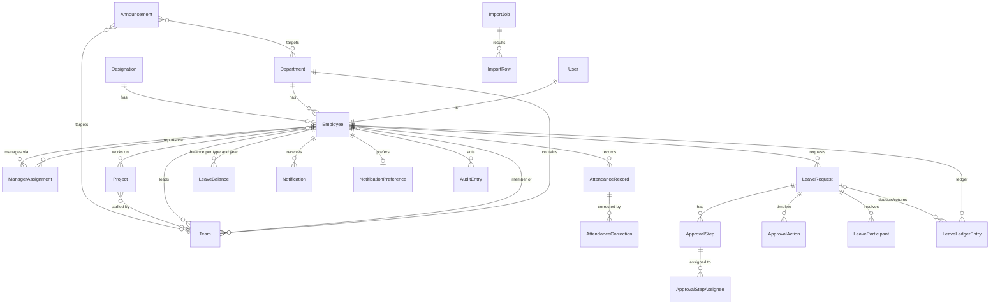

# FormbaxHR — Backend API Implementation Specification

> **Purpose:** everything a developer needs to build the Django 5.2 + Django REST Framework + PostgreSQL backend that replaces the frontend's mock services, without re-reading the frontend.
> **Source of truth:** the frontend code on `dev-main` (Phases 1–8): every `src/features/*/api/*.http.ts` file (the exact requests the frontend sends), the Zod schemas in `src/features/*/schemas/` (the exact responses it accepts), and the mock backends in `src/services/mock/` (the business behaviour the backend must reproduce). Decisions: `docs/DECISIONS.md` (D-…, Q-…).
> **Status labels used throughout:**
> - `CONFIRMED`: verified in frontend code or a confirmed decision.
> - `PROPOSED`: recommended implementation choice; the frontend works with it.
> - `UNRESOLVED`: needs a business decision (Q-… in `docs/DECISIONS.md`); the frontend currently uses a provisional rule.
> - `NOT IMPLEMENTED`: the frontend has no screen or call for it.
>
> Replaces the earlier per-phase contract notes in this file (same content, extended and reorganised). Nothing here describes a running backend.

## Contents

A. Backend architecture · B. API conventions · C. Authentication and users · D. Employees · E. Organization · F. Attendance · G. Leave and approvals · H. Notifications and announcements · I. Excel imports · J. Reports · K. Settings · L. Audit log · M. Database models · N. Permissions matrix · O. Frontend-to-backend mapping · P. API summary · Q. Implementation order · R. Unresolved decisions · S. Contract mismatches and gaps

### Example data used in every example

All examples share these records (IDs are UUIDs, see B.2). "Today" is **Wednesday 25 Nov 2026**, Pakistan time.

| Record | ID | Details |
|---|---|---|
| Sana Demo | `00000000-0000-4000-8000-000000000001` | HR Administrator, Human Resources, `FBX-1001` |
| Imran Demo | `00000000-0000-4000-8000-000000000002` | Manager, Engineering, `FBX-1002` |
| Farah Demo | `00000000-0000-4000-8000-000000000003` | Senior PM, Delivery, `FBX-1003` |
| Usman Demo | `00000000-0000-4000-8000-000000000004` | Associate PM, Delivery, `FBX-1004`, manager Farah |
| Zainab Demo | `00000000-0000-4000-8000-000000000005` | Team Lead (Frontend team), Engineering, `FBX-1005`, manager Imran |
| Ali Demo | `00000000-0000-4000-8000-000000000006` | Employee, Engineering, Frontend team, project Payroll Portal, `FBX-1006`, manager Imran |
| Kamran Aslam | `00000000-0000-4000-8000-000000000112` | Employee, Finance, no manager, `FBX-1112` |
| Engineering | `d0000000-0000-4000-8000-000000000001` | department, code `ENG` |
| Finance | `d0000000-0000-4000-8000-000000000005` | department, code `FIN` |
| Software Engineer | `de000000-0000-4000-8000-000000000008` | designation |
| Frontend | `70000000-0000-4000-8000-000000000001` | team, Engineering, lead Zainab |
| Payroll Portal Revamp | `b0000000-0000-4000-8000-000000000001` | project `PPR`, Senior PM Farah, Associate PM Usman, team Frontend |
| Ali's attendance 25 Nov | `a7700000-0000-4000-8000-000000000001` | check-in 09:20:00, open |
| Ali's leave request | `1e000000-0000-4000-8000-000000000041` | Casual, 14–15 Dec 2026, 2 days |

---

## A. Backend architecture

### A.1 Project structure (PROPOSED)

```
backend/
├── manage.py
├── config/                     settings/{base,dev,prod}.py, urls.py, asgi.py, wsgi.py
├── apps/
│   ├── core/                   shared: base models (UUID pk, timestamps), pagination, exception handler,
│   │                           permissions helpers, Pakistan-time utilities, CSV-safe helpers
│   ├── accounts/               User, JWT login/refresh/logout, invitations, password reset, /auth/me
│   ├── organization/           Department, Designation, Team, Project
│   ├── employees/              Employee, manager assignments, reporting scope, directory
│   ├── attendance/             AttendanceRecord, corrections, policy service, summaries
│   ├── leave/                  requests, routing, workflow engine, ledger, balances, approvals inbox
│   ├── notifications/          Notification, preferences, announcements, reminder jobs
│   ├── imports/                ImportJob, ImportRow, file parsing, dry run, execution
│   ├── reports/                read-only aggregate endpoints (no models)
│   ├── company_settings/       CompanySettings (singleton), Holiday
│   ├── audit/                  AuditEntry and the `audit.record()` service
│   └── dashboards/             GET dashboard/<role>/ aggregates (no models)
└── tests/                      per-app pytest suites
```

Each app: `models.py`, `serializers.py`, `services.py` (business logic, the only place that writes), `selectors.py` (scoped read queries), `views.py` (thin DRF views/viewsets), `urls.py`, `permissions.py`, `tests/`. Views never contain business rules; services are plain functions called inside `transaction.atomic()`.

### A.2 Apps and responsibilities

| App | Owns | Depends on |
|---|---|---|
| `core` | base model, `Page` pagination, error envelope, `karachi_now()`, `to_karachi()` | — |
| `accounts` | authentication, tokens, invitations, password reset | `core`, `employees` (user ↔ employee) |
| `organization` | departments, designations, teams, projects | `core` |
| `employees` | employee records, manager assignments, **scope resolution** (`visible_employee_ids(user)`) | `organization`, `audit` |
| `attendance` | check-in/out, classification, corrections | `employees`, `leave` (on-leave counts), `audit`, `notifications` (reminders) |
| `leave` | routing, workflow, ledger, balances, approvals | `employees`, `company_settings`, `notifications`, `audit` |
| `notifications` | notifications, preferences, announcements | `employees`, `organization` |
| `imports` | import jobs | `employees`, `attendance`, `leave`, `audit` |
| `reports` | report aggregates | `employees`, `attendance`, `leave` |
| `company_settings` | company details, default allocation, approval options, holidays | `audit` |
| `audit` | append-only audit log | — |
| `dashboards` | role dashboard aggregates | most apps |

### A.3 Versioning, database, authentication, permissions

- **Versioning** (CONFIRMED path): all endpoints under `/api/v1/`. A breaking change gets `/api/v2/`; additive changes stay in v1.
- **Database** (PROPOSED): PostgreSQL 16+, UUID primary keys (`uuid.uuid4`), `TIMESTAMP WITH TIME ZONE` for instants, `DATE` for calendar dates, database constraints for every uniqueness rule listed in section M, `CHECK` constraints for simple invariants.
- **Authentication** (CONFIRMED D-078, D-079): JWT with `djangorestframework-simplejwt` + its `token_blacklist` app. Access token (≈5–15 min) returned in the JSON body and kept **in memory** by the frontend; refresh token in an **httpOnly, Secure, SameSite cookie** set by Django, **rotated** on every refresh, the old one **blacklisted**; logout blacklists the refresh token.
- **Permissions** (CONFIRMED D-044, D-027): DRF permission classes for role checks (`IsHRAdmin`, `HasDirectoryScope`), plus object-level scope in selectors: every list/detail query starts from `employees.selectors.visible_employee_ids(user)` (section N). Out-of-scope objects answer **404**, not 403 (CONFIRMED in mocks, so existence is not revealed).

### A.4 Serializers, services, transactions

- **Serializers** validate shape and simple field rules (lengths, formats, enum values). **Services** enforce business rules (routing, balances, overlaps, policy) and raise `ValidationError({"field": ["message"]})` or a domain exception mapped to 409 (B.7).
- **Transactions** (CONFIRMED D-069): every write is one `transaction.atomic()` that also writes its audit entry and notifications (or an outbox row). Balance-changing operations lock the affected `LeaveBalance` rows with `select_for_update()`; leave decisions lock the `LeaveRequest` row and compare `version` (optimistic token, section G).
- **Idempotency** (CONFIRMED D-069, R-013): a decision on an already-decided request answers 409 `already_decided`; an import executes at most once (409 `already_executed`); check-in/out are unique per employee and day (409).

### A.5 Pagination, filtering, files, errors, audit

- **Pagination** (CONFIRMED): DRF `PageNumberPagination` with `page` and `page_size` query parameters; response `{count, next, previous, results}` (B.5). Non-paginated lists return a plain JSON array (as listed per endpoint).
- **Filtering** (PROPOSED): `django-filter` `FilterSet` per list endpoint with exactly the query parameters listed per endpoint; `ordering` via DRF `OrderingFilter` where listed.
- **Files** (PROPOSED): leave attachments and import files stored with `django-storages` (S3-compatible) or local `MEDIA_ROOT` in development; never served from a guessable public URL; content type sniffed (not trusted from the client); size checked before reading.
- **Errors**: one exception handler producing the formats in B.7.
- **Audit**: `audit.services.record(actor, action, entity, entity_id, entity_label, before, after, reason)` called inside the same transaction as the change (section L).

### A.6 Background work (PROPOSED)

Only two jobs need scheduling: attendance reminders (9:15 AM and 9:00 AM Pakistan time, section H) and, optionally, large imports. Use **Celery + Redis + celery-beat**, or start with a management command run by cron for reminders and synchronous imports (≤ 5,000 rows) — both satisfy the frontend, which never waits on a job id.

---

## B. API conventions

### B.1 Base URL and transport (CONFIRMED)

- Base URL: `VITE_API_BASE_URL`, default `http://localhost:8000/api/v1`. All paths in this document are relative to it and **end with a slash**.
- The frontend sends `Accept: application/json` and `Content-Type: application/json` for JSON bodies; `multipart/form-data` for uploads (leave attachment, import file).
- Requests time out after 20 s on the client.
- Credentials: `credentials: 'include'` for `auth/login/`, `auth/token/refresh/`, `auth/logout/` (refresh cookie). CORS must allow the frontend origin with `Access-Control-Allow-Credentials: true`.

### B.2 Field names, IDs and types

| Convention | Rule | Status |
|---|---|---|
| JSON keys | `snake_case`; the frontend camelizes **all** response keys recursively (see mismatch S.2 for maps) | CONFIRMED |
| IDs | **strings** in every response (`z.string()`); only the auth user also accepts a number | CONFIRMED |
| ID format | UUID v4 | PROPOSED |
| Instants | ISO 8601 **with offset**, e.g. `"2026-11-25T09:20:00.000+05:00"` (strings without offset are rejected) | CONFIRMED |
| Dates | `"YYYY-MM-DD"` (Pakistan calendar date) | CONFIRMED |
| Durations | integer milliseconds (`duration_ms`) | CONFIRMED |
| Enums | lowercase `snake_case` strings listed per field | CONFIRMED |
| Nullable | explicit `null`, never omitted (schemas use `.nullable()`, not `.optional()`) | CONFIRMED |

### B.3 Time zone (CONFIRMED D-050, D-028)

- All policy decisions (Late-In, attendance date, leave days, reminders, report ranges) use **`Asia/Karachi`**, never the server or browser zone. Django: `USE_TZ = True`, `TIME_ZONE = "Asia/Karachi"`; store instants in UTC; compute calendar dates with `zoneinfo.ZoneInfo("Asia/Karachi")`.
- Return instants with the Karachi offset (`+05:00`) and millisecond precision; never round.
- Query parameters `from`/`to` are Pakistan calendar dates, **inclusive**.

### B.4 Authentication header (CONFIRMED)

`Authorization: Bearer <access token>` on every authenticated request. On `401` the frontend calls `auth/token/refresh/` once (serialized across tabs) and retries the request once.

### B.5 Pagination (CONFIRMED)

```http
GET /api/v1/employees/?page=2&page_size=25
```

```json
{
  "count": 53,
  "next": "http://localhost:8000/api/v1/employees/?page=3&page_size=25",
  "previous": "http://localhost:8000/api/v1/employees/?page=1&page_size=25",
  "results": []
}
```

`next`/`previous` may be absolute or relative URLs or `null`; the frontend only uses `count` and `results`. Allowed page sizes are listed per endpoint; enforce a `max_page_size` of 100, except where an endpoint documents a larger export limit (attendance and leave exports request 5,000).

### B.6 Filtering, search, sorting (CONFIRMED per endpoint)

Exact parameter names per endpoint. Empty parameters are omitted by the client. Search is case-insensitive substring. Sorting uses DRF `ordering` with `-` for descending (employees only; other lists have a fixed order documented per endpoint).

### B.7 Status codes and error format

| Status | When | `code` (body) |
|---|---|---|
| 200 | read or update succeeded | — |
| 201 | created (frontend accepts 200 or 201) | — |
| 204 | logout / no content | — |
| 400 | validation failed | `validation_error` (or a specific code, e.g. `no_approver`) |
| 401 | not signed in / token expired | `unauthorized` / `token_not_valid` |
| 403 | signed in but role not allowed | `forbidden` |
| 404 | not found **or outside the caller's scope** | `not_found` |
| 409 | state conflict | `already_checked_in`, `already_checked_out`, `conflict`, `already_decided`, `insufficient_balance`, `cannot_cancel`, `dry_run_required`, `already_executed`, `duplicate` |
| 429 | rate limited | `rate_limited` |
| 5xx | server error | — |

The frontend accepts three error shapes (CONFIRMED `src/services/api/api-error.ts`):

```json
{ "detail": "You do not have permission to do this.", "code": "forbidden" }
```

```json
{ "email": ["An employee with this email already exists."], "non_field_errors": ["…"] }
```

```json
{ "error": { "code": "validation_error", "message": "Some fields are not valid.", "fields": { "reason": ["Give a reason (at least 5 characters)."] } } }
```

**PROPOSED:** use the envelope form for all errors, with `code` always set:

```json
{
  "error": {
    "code": "validation_error",
    "message": "Some fields are not valid.",
    "fields": { "end_date": ["The end date must be on or after the start date."] }
  }
}
```

`message` is shown to users, so it must be safe, plain language. **Field keys: see mismatch S.1** (forms expect camelCase keys).


---

## C. Authentication and users

Frontend: `src/features/authentication/` (`auth.http.ts`, `auth.schema.ts`, `session/`), pages Login, Forgot password, Reset password, Accept invitation, Profile. Behaviour CONFIRMED by D-078, D-079, D-081, D-082.

### C.1 Roles (CONFIRMED D-040)

| Role value | Label | Data visibility (D-044, D-085) |
|---|---|---|
| `hr_admin` | HR Administrator | Whole organization; all HR changes |
| `manager` | Manager | Own record + direct **and indirect** reports |
| `senior_pm` | Senior Project Manager | Own record + teams and members of projects where they are Senior PM |
| `associate_pm` | Associate Project Manager | Own record + teams and members of projects where they are Associate PM |
| `team_lead` | Team Lead | Own record + members of teams they lead |
| `employee` | Employee | Own record only (no directory, no team views) |

People also see leave requests they take part in (decision-maker, reviewer, recipient). Full matrix: section N.

### C.2 User object (CONFIRMED `apiUserSchema`)

Returned by login, refresh and `auth/me/`. This schema is read **without** camelization, so keys must be exactly:

```json
{
  "id": "00000000-0000-4000-8000-000000000006",
  "email": "ali.demo@formbaxhr.test",
  "first_name": "Ali",
  "last_name": "Demo",
  "role": "employee",
  "employee_code": "FBX-1006",
  "designation": "Software Engineer",
  "department": "Engineering"
}
```

`designation` and `department` are display names (nullable).

### C.3 Endpoints

#### `POST auth/login/` — sign in (Login page)

- Auth: none. Roles: any account with status `active`. Credentials: include.
- Request:

```json
{ "email": "ali.demo@formbaxhr.test", "password": "correct horse battery" }
```

- `200 OK` + `Set-Cookie: refresh=<token>; HttpOnly; Secure; SameSite=Lax; Path=/api/v1/auth/`:

```json
{
  "access": "eyJhbGciOiJIUzI1NiIsInR5cCI6IkpXVCJ9…",
  "user": { "id": "00000000-0000-4000-8000-000000000006", "email": "ali.demo@formbaxhr.test", "first_name": "Ali", "last_name": "Demo", "role": "employee", "employee_code": "FBX-1006", "designation": "Software Engineer", "department": "Engineering" }
}
```

- `401` `invalid_credentials` — **same message for unknown email, wrong password, invited or inactive account** (no account enumeration, D-082):

```json
{ "error": { "code": "invalid_credentials", "message": "Email or password is incorrect.", "fields": {} } }
```

- `400` validation (`email`, `password` missing); `429` too many attempts (PROPOSED throttle 5/min per IP+email).

#### `POST auth/token/refresh/` — restore session and refresh access (app start, after a 401)

- Auth: refresh cookie only (no body, no Authorization). Credentials: include.
- `200 OK`: same body as login; sets a **new** refresh cookie (rotation) and blacklists the old one.
- `401` when the cookie is missing, expired or blacklisted → the frontend treats the user as signed out. `503`/network errors are **not** treated as sign-out (CONFIRMED).

#### `POST auth/logout/` — sign out (account menu)

- Auth: Bearer + refresh cookie. Request: no body.
- `204 No Content`; blacklists the refresh token and clears the cookie (`Max-Age=0`). The frontend signs out locally even if this call fails.

#### `GET auth/me/` — current user (profile page, session check)

- Auth: Bearer. `200` → user object (C.2). `401` when not signed in.

#### `POST auth/password-reset/` — request a reset email (Forgot password)

- Auth: none. Request `{ "email": "ali.demo@formbaxhr.test" }`.
- `204` (or `200`) **always**, whether or not the email exists (no enumeration). Sends a single-use, time-limited link `https://<frontend>/reset-password?token=<token>`.
- `400` if the email is not a valid address; `429` throttled.

#### `POST auth/password-reset/validate/` — check a reset token (Reset password page load)

- Auth: none. Request `{ "token": "c2Vjb25kLXRva2Vu" }`.
- `200`:

```json
{ "status": "valid", "email": "ali.demo@formbaxhr.test" }
```

`status` ∈ `valid`, `invalid`, `expired`, `used` (`email` only when valid, optional). Never 404 for a bad token: return `{"status": "invalid"}`.

#### `POST auth/password-reset/confirm/` — set a new password

- Request `{ "token": "c2Vjb25kLXRva2Vu", "password": "new long passphrase" }`. `204` on success; marks the token used; blacklists the user's existing refresh tokens (PROPOSED).
- `400` `token_invalid` / `token_expired` / `token_used`:

```json
{ "error": { "code": "token_expired", "message": "This reset link is no longer valid. Request a new one.", "fields": {} } }
```

- `400` `validation_error` with `fields.password` (Django password validators; frontend checks min 8, max 128, not only digits — D-081, UNRESOLVED Q-AUTH-01).

#### `POST auth/invitations/validate/` and `POST auth/invitations/accept/` — invited employee sets a password

Identical shapes to the reset pair: validate `{token}` → `{status, email?}`; accept `{token, password}` → `204`, sets the employee status from `invited` to `active`. Errors `token_invalid|token_expired|token_used`. Invitations are created when HR creates an employee (D. `POST employees/`).

#### Not implemented in the frontend

| Feature | Status |
|---|---|
| Change password while signed in | NOT IMPLEMENTED (no screen; reset flow covers it) |
| Edit own profile | NOT IMPLEMENTED (profile page is read-only; HR edits employees) |
| MFA / SSO, idle timeout, "remember me" | NOT IMPLEMENTED, UNRESOLVED Q-AUTH-03, Q-AUTH-04 |
| Resend invitation | NOT IMPLEMENTED (UNRESOLVED Q-AUTH-02) |

### C.4 Health (CONFIRMED `health.http.ts`)

`GET health/` — Auth: none. `200` `{"status": "ok", "checked_at": "2026-11-25T09:00:00.000+05:00"}`; `status` ∈ `ok`, `degraded`.

---

## D. Employee management

Frontend: `src/features/employees/` (directory, profile, create, edit pages; `employee.http.ts`; `employee.schema.ts`). Mock: `src/services/mock/hr-store.ts`.

### D.1 Fields (CONFIRMED `employeeSchema`, `employeeFormSchema`)

| Field | Type | Rules |
|---|---|---|
| `id` | string (UUID) | read-only |
| `employee_code` | string \| null | assigned by the backend on create (format UNRESOLVED Q-ORG-01; mock uses `FBX-####`) |
| `first_name`, `last_name` | string | required, 1–50 chars |
| `email` | email | required, unique (case-insensitive), lowercase |
| `phone` | string \| null | optional, `^\+?[0-9][0-9 -]{6,18}$` |
| `role` | enum (C.1) | required; HR cannot change their own role (D-084) |
| `department_id` | string \| null | required on write; must be an active department |
| `designation_id` | string \| null | required on write; must be an active designation |
| `joining_date` | date | required |
| `status` | `invited` \| `active` \| `inactive` | read-only; set by create/activate/deactivate/invitation accept |
| `manager_ids` | string[] | 0..n active employees; never self; **no reporting loops** |
| `team_ids` | string[] | active teams |
| `project_ids` | string[] | active projects |
| `deactivation_reason` | string \| null | read-only |

No national-ID or sensitive identifiers are collected (D-084). No hard delete (R-008): `DELETE` is **NOT IMPLEMENTED** by design. Employee documents: **NOT IMPLEMENTED**.

### D.2 `GET employees/` — directory (Employee directory page, global search)

- Roles: all except `employee` (`403`). Scope: C.1.
- Query: `page`, `page_size` (10, 25, 50), `search` (first/last name, email, employee code), `department`, `team`, `role`, `status`, `manager` (direct reports of that id), `ordering` ∈ `last_name`, `-last_name`, `joining_date`, `-joining_date`, `employee_code`, `-employee_code`.

```http
GET /api/v1/employees/?search=ali&department=d0000000-0000-4000-8000-000000000001&page=1&page_size=25&ordering=last_name
```

```json
{
  "count": 1,
  "next": null,
  "previous": null,
  "results": [
    {
      "id": "00000000-0000-4000-8000-000000000006",
      "employee_code": "FBX-1006",
      "first_name": "Ali",
      "last_name": "Demo",
      "email": "ali.demo@formbaxhr.test",
      "role": "employee",
      "status": "active",
      "department_name": "Engineering",
      "designation_title": "Software Engineer",
      "manager_names": ["Imran Demo"],
      "joining_date": "2023-05-08"
    }
  ]
}
```

### D.3 `GET employees/{id}/` — profile (Employee profile, edit form)

Roles: anyone for their own id; others within scope; `404` otherwise.

```json
{
  "id": "00000000-0000-4000-8000-000000000006",
  "employee_code": "FBX-1006",
  "first_name": "Ali",
  "last_name": "Demo",
  "email": "ali.demo@formbaxhr.test",
  "phone": null,
  "role": "employee",
  "department_id": "d0000000-0000-4000-8000-000000000001",
  "designation_id": "de000000-0000-4000-8000-000000000008",
  "joining_date": "2023-05-08",
  "status": "active",
  "manager_ids": ["00000000-0000-4000-8000-000000000002"],
  "team_ids": ["70000000-0000-4000-8000-000000000001"],
  "project_ids": ["b0000000-0000-4000-8000-000000000001"],
  "deactivation_reason": null
}
```

### D.4 `POST employees/` — create (Add employee page)

Roles: `hr_admin` only. Request (all D.1 write fields; no `id`, `employee_code`, `status`):

```json
{
  "first_name": "Areeba",
  "last_name": "Khan",
  "email": "areeba.khan@formbaxhr.test",
  "phone": null,
  "role": "employee",
  "department_id": "d0000000-0000-4000-8000-000000000001",
  "designation_id": "de000000-0000-4000-8000-000000000008",
  "joining_date": "2026-12-07",
  "manager_ids": ["00000000-0000-4000-8000-000000000002"],
  "team_ids": ["70000000-0000-4000-8000-000000000001"],
  "project_ids": []
}
```

`201` → profile (D.3) with `status: "invited"` and a new `employee_code`. Side effects: invitation email (C.3), audit `created`, first leave allocation (G). Errors:

```json
{
  "error": {
    "code": "validation_error",
    "message": "Some fields are not valid.",
    "fields": {
      "email": ["An employee with this email already exists."],
      "manager_ids": ["This would create a reporting loop: Imran Demo → Areeba Khan → Imran Demo."]
    }
  }
}
```

Other field errors: `department_id`/`designation_id` "Choose an active department/designation.", `manager_ids` "An employee cannot report to themselves." / "Managers must be existing, active employees.", `team_ids`, `project_ids`. `403` for non-HR.

### D.5 `PATCH employees/{id}/` — edit (Edit employee page)

HR only. **Only changed fields are sent** (CONFIRMED `employee-diff.ts`); list fields replace the whole list. Example: `{"phone": "+92 300 1111111", "team_ids": []}` → `200` profile. Same validation as create; `role` error "You cannot change your own role. Ask another HR administrator." when HR edits themselves. Audit `updated` with before/after of changed fields.

### D.6 `POST employees/{id}/deactivate/` and `POST employees/{id}/activate/`

HR only; never on your own account (`400`). Deactivate request `{"reason": "Left the company"}` (reason required, ≥ 5 chars — provisional D-084, UNRESOLVED Q-ORG-03) → `200` profile with `status: "inactive"`, `deactivation_reason` set. Activate: no body → `200`, status `active`, or `invited` if the person never accepted the invitation. Effects on pending leave of a deactivated employee: UNRESOLVED Q-ORG-03. Audit `deactivated`/`activated`.

### D.7 `GET employees/reporting-lines/` — org chart and pickers

Roles: all signed-in users (provisional). Non-paginated array; inactive people included (the chart can show them):

```json
[
  {
    "id": "00000000-0000-4000-8000-000000000006",
    "name": "Ali Demo",
    "designation": "Software Engineer",
    "department_name": "Engineering",
    "role": "employee",
    "status": "active",
    "manager_ids": ["00000000-0000-4000-8000-000000000002"]
  }
]
```

---

## E. Organization management

Frontend: `src/features/organization/` (Organization page tabs, org chart; `organization.http.ts`). All lists are **non-paginated arrays** (CONFIRMED). Reads: every signed-in user (pickers, filters, org chart). Writes: `hr_admin` only. Nothing is deleted: `PATCH {…}/{id}/ {"status": "inactive"}` deactivates (R-008). Single company (provisional D-084, UNRESOLVED Q-ORG-02).

| Resource | List response item | Create/patch body | Rules |
|---|---|---|---|
| `departments/` | `{id, name, code, status, headcount}` | `{name, code}` | name 2–80, unique; code ≤ 12 `[A-Za-z0-9-]`, uppercased, unique, optional (`null`) |
| `designations/` | `{id, title, status, headcount}` | `{title}` | 2–80, unique |
| `teams/` | `{id, name, department_id, team_lead_id, member_ids, status}` | `{name, department_id, team_lead_id, member_ids}` | name unique; department active; lead and members active employees; `member_ids` replaces membership (updates employees' `team_ids`) |
| `projects/` | `{id, name, code, senior_pm_id, associate_pm_id, team_ids, status}` | `{name, code, senior_pm_id, associate_pm_id, team_ids}` | name 2–120; code 2–12 required, unique; `senior_pm_id` must have role `senior_pm`, `associate_pm_id` role `associate_pm` (`400` otherwise) |

`headcount` = active employees assigned. Example:

```http
POST /api/v1/teams/
```

```json
{
  "name": "Frontend",
  "department_id": "d0000000-0000-4000-8000-000000000001",
  "team_lead_id": "00000000-0000-4000-8000-000000000005",
  "member_ids": ["00000000-0000-4000-8000-000000000006"]
}
```

`201`:

```json
{
  "id": "70000000-0000-4000-8000-000000000001",
  "name": "Frontend",
  "department_id": "d0000000-0000-4000-8000-000000000001",
  "team_lead_id": "00000000-0000-4000-8000-000000000005",
  "member_ids": ["00000000-0000-4000-8000-000000000006"],
  "status": "active"
}
```

Errors: `{"error": {"code": "validation_error", "message": "…", "fields": {"name": ["This name is already used."]}}}`; deactivate: `PATCH departments/{id}/ {"status": "inactive"}` → `200` item (the UI warns when people are still assigned; the backend allows it).

**Relationships (CONFIRMED):** employee → one department (Q-ORG-04 provisional), one designation, many teams, many projects, many managers; team → one department, optional lead; project → optional Senior PM, optional Associate PM, many teams. Reporting hierarchy = the `manager_ids` graph (must be acyclic, multiple managers allowed, no manager allowed). Scope rules use these relations (C.1).


---

## F. Attendance

Frontend: `src/features/attendance/` (check-in card, My attendance, Attendance records, correction dialogs; `attendance.http.ts`; `lib/policy.ts`). Mock: `src/services/mock/attendance-store.ts`. **The backend is authoritative** for instants, dates, classifications and durations (D-028); the frontend only displays them and uses the same pure policy for a live preview.

### F.1 Policy (CONFIRMED D2, D-050; provisional items D-086)

| Rule | Value | Status |
|---|---|---|
| Time zone | `Asia/Karachi` | CONFIRMED |
| Official check-in | 09:00 | CONFIRMED |
| Grace | 15 minutes: **09:15:00.000 is on time; 09:15:00.001 is Late-In** | CONFIRMED (ms rule D-086) |
| Before 09:00:00 | `early` (allowed; actual time kept) | CONFIRMED |
| Late-In | tracking only; no payroll effect anywhere | CONFIRMED D-053 |
| Official check-out | 18:00; from **17:45:00** onward no early-departure flag (`within_window`) | CONFIRMED |
| Check-out before 17:45 | `before_window`, shown neutrally, **no penalty/flag/reason** | UNRESOLVED Q-ATT-01 |
| Duration | `check_out_at − check_in_at`, exact ms; no rounding; **no break deduction** | CONFIRMED |
| Sessions per day | one (second check-in → 409) | UNRESOLVED Q-ATT-03 |
| Forgotten check-out | session stays open; flagged "missing check-out" from the next day; never auto-closed | UNRESOLVED Q-ATT-06 |
| Absent | not derived; `absent` count is the backend's number (mock 0) | UNRESOLVED Q-ATT-02 |
| Weekends/holidays in attendance | no rule | UNRESOLVED Q-ATT-05 |
| Location / IP | not captured | UNRESOLVED Q-ATT-07 |
| Corrections | HR only, reason ≥ 5 chars, same day, check-out after check-in, no time limit, no approval | provisional D-086, UNRESOLVED Q-ATT-04 |

**Classification (server, pseudo-code):**

```python
KARACHI = ZoneInfo("Asia/Karachi")
def classify_check_in(at):            # at: aware datetime
    local = at.astimezone(KARACHI)
    ms = (local.hour*3600 + local.minute*60 + local.second)*1000 + local.microsecond//1000
    if ms < 9*3600*1000: return "early"
    if ms <= (9*3600 + 15*60)*1000: return "on_time"     # 09:15:00.000 inclusive
    return "late"
def classify_check_out(at):
    local = at.astimezone(KARACHI)
    return "within_window" if local.time() >= time(17, 45) else "before_window"
def attendance_date(check_in_at): return check_in_at.astimezone(KARACHI).date()
```

Session state shown by the UI (derived on the client from the record): `in_progress` (open, today), `complete`, `incomplete` (open, earlier day), `not_checked_in`.

### F.2 Record (CONFIRMED `attendanceRecordSchema`)

```json
{
  "id": "a7700000-0000-4000-8000-000000000001",
  "employee_id": "00000000-0000-4000-8000-000000000006",
  "employee_name": "Ali Demo",
  "department_name": "Engineering",
  "date": "2026-11-25",
  "check_in_at": "2026-11-25T09:20:00.000+05:00",
  "check_out_at": null,
  "check_in_status": "late",
  "check_out_status": null,
  "duration_ms": null,
  "corrected": false
}
```

After check-out at 18:02:41: `"check_out_at": "2026-11-25T18:02:41.000+05:00"`, `"check_out_status": "within_window"`, `"duration_ms": 31361000`.

### F.3 Endpoints

| # | Method and path | Roles | Purpose (screen) |
|---|---|---|---|
| F1 | `GET attendance/me/today/` | all | Check-in card (My attendance, Employee dashboard) |
| F2 | `POST attendance/me/check-in/` | all | Check in |
| F3 | `POST attendance/me/check-out/` | all | Check out |
| F4 | `GET attendance/me/?from=&to=` | all | Own history and calendar |
| F5 | `GET attendance/?…` | HR, Manager, Team Lead, Senior/Associate PM | Attendance records (team or organization) |
| F6 | `GET attendance/{id}/` | in scope | (detail; used by the correction flow) |
| F7 | `POST attendance/{id}/corrections/` | HR | Correct a record |
| F8 | `GET attendance/{id}/corrections/` | in scope | Correction history |
| F9 | `GET attendance/summary/` | all (scoped) | Live team attendance on dashboards |

**F1** `200`:

```json
{ "date": "2026-11-25", "record": null }
```

(`record` is the F.2 object once checked in.)

**F2** `POST attendance/me/check-in/` — no body; **the server takes the time** (the client never sends it). `201` → F.2 record. `409`:

```json
{ "error": { "code": "already_checked_in", "message": "You have already checked in today.", "fields": {} } }
```

**F3** `POST attendance/me/check-out/` — no body. `200` → record with check-out. `400` `not_checked_in` "Check in before checking out."; `409` `already_checked_out`. The frontend never retries these automatically.

**F4** `GET attendance/me/?from=2026-11-01&to=2026-11-25` → **array** of own records, newest first, dates inclusive.

**F5** `GET attendance/?from=&to=&page=&page_size=&employee=&department=&team=&filter=` — DRF page of records within scope; `employee` role → `403`. `filter` ∈ `late` (`check_in_status = late`), `incomplete` (open and `date < today`), `corrected`. Page sizes 25/50/100; CSV export requests `page_size=5000` (allow it for this endpoint). Order: `date` desc, then `employee_name`.

**F7** `POST attendance/a7700000-0000-4000-8000-000000000001/corrections/`:

```json
{ "check_in_at": "2026-11-25T09:00:00.000+05:00", "check_out_at": "2026-11-25T18:05:00.000+05:00", "reason": "Biometric device was offline" }
```

`200` → updated record with `"corrected": true` and recomputed statuses/duration. Errors `400` with fields `reason` ("Give a reason for this correction."), `check_in_at` ("A check-out needs a check-in time.", "The time must be on the same day as the record."), `check_out_at` ("Check-out must be after check-in."). `403` non-HR, `404` unknown. Writes a correction entry and an audit entry (`corrected`).

**F8** → array, newest first:

```json
[
  {
    "id": "c0000000-0000-4000-8000-000000000001",
    "record_id": "a7700000-0000-4000-8000-000000000001",
    "actor_name": "Sana Demo",
    "at": "2026-11-25T12:10:00.000+05:00",
    "reason": "Biometric device was offline",
    "before": { "check_in_at": "2026-11-25T09:20:00.000+05:00", "check_out_at": null },
    "after": { "check_in_at": "2026-11-25T09:00:00.000+05:00", "check_out_at": "2026-11-25T18:05:00.000+05:00" }
  }
]
```

**F9** today within the caller's scope (employee: only themselves):

```json
{ "date": "2026-11-25", "total": 9, "present": 6, "late": 2, "on_leave": 1, "not_checked_in": 2, "absent": 0, "incomplete": 1 }
```

`on_leave` = active people with approved leave covering today (working day) and no check-in; `not_checked_in = total − present − on_leave`; `incomplete` = open sessions from earlier days; `absent` UNRESOLVED (return 0 until Q-ATT-02).

### F.4 Integrity (PROPOSED)

- Unique constraint `(employee_id, date)` on `AttendanceRecord` (enforces one session/day and makes concurrent double check-ins fail with `IntegrityError` → 409).
- Check-out: `SELECT … FOR UPDATE` on today's record, then require `check_in_at` set and `check_out_at` null.
- `CHECK (check_out_at IS NULL OR check_out_at > check_in_at)`.
- `duration_ms`, `check_in_status`, `check_out_status`, `date` computed in the service on every write (stored for querying/reporting).
- Late-arrival and employee attendance reports: section J.


---

## G. Leave management and approvals

Frontend: `src/features/leave/` (My leave, Apply, Request page, Approvals inbox, Leave records, HR Leave balances; `leave.http.ts`; `lib/{routing,workflow,balance,duration,leave-policy}.ts`). Mock: `src/services/mock/leave-store.ts`. The pure modules in `lib/` are the reference implementation: port them to Python services and reuse their test cases.

### G.1 Rules

| Rule | Status |
|---|---|
| Types `medical_sick` (Medical/Sick), `casual`, `annual`; default 7 + 7 + 7 = 21 days/year, separate balances | CONFIRMED D-060 |
| Only **approved** leave deducts, from its own category; pending/declined/cancelled never deduct | CONFIRMED D-061 |
| Append-only ledger; HR configures allocations; employees see allocated/used/remaining | CONFIRMED D-062 |
| Duration = Monday–Friday, **company holidays excluded**, whole days only (no half days) | CONFIRMED D-088 |
| No negative balance: submission and approval refused if it does not fit; pending requests do **not** reserve days | CONFIRMED D-088 |
| No overlap with own pending/approved requests; backdating allowed (`backdated: true`) | CONFIRMED D-088 |
| Requester may cancel pending requests, and approved ones until the day **before** the start (days returned by a reversal) | CONFIRMED D-088 |
| Attachment optional: PDF/JPG/PNG ≤ 5 MB | CONFIRMED D-088 |
| Reason required (≥ 5 chars); declines, HR overrides and comments need ≥ 5 chars | provisional D-090 |
| A request stays within one leave year (calendar year) | provisional D-090, UNRESOLVED Q-LEAVE-01 |
| Proration, carry-forward, encashment, expiry | none built; UNRESOLVED Q-LEAVE-02, Q-LEAVE-03 |
| Escalation/timeout | none; UNRESOLVED Q-APPR-07 |
| First allocation of a year for an employee without one = HR default allocation (settings) | PROPOSED D-097 |

### G.2 Routing and roles in a request (CONFIRMED D-064…D-068, D-089)

| Requester | Decided by (any one, unless settings say otherwise) |
|---|---|
| Employee / Team Lead with active manager(s) | the selected managers (default: all their managers) |
| Employee / Team Lead without manager | HR Administrators |
| Manager | HR |
| Senior PM | HR |
| Associate PM | Senior PM(s) of projects where they are Associate PM; HR if none (provisional D-090) |
| HR Administrator | **another** HR Administrator; `400 no_approver` if none exists |

- **Optional reviewers** (only when routed to managers): the Team Lead of the requester's active teams and the Associate PM of their active projects; they comment and recommend, never decide (D-065).
- **Recipients**: all active HR Administrators except the requester, `mandatory: true`, cannot be removed (D-064).
- Nobody decides or reviews their own request (D-068).
- **HR override**: any HR Administrator who is not a decision-maker may approve/decline a pending request with a reason (D-089).
- **Configurable** (D-067, settings K): decision rule `any` (default) / `all` / `sequential`; review step `required` (default false).

**Workflow engine** (port `lib/workflow.ts`): steps in order; a `required` step blocks later steps until complete; `parallel+any` → first decision is final; `parallel+all` → all approve, one decline declines; `sequential` → assignees act in order. Status is derived:

| Status | When |
|---|---|
| `pending` | no actions |
| `under_review` | a recommendation or comment exists, no decision |
| `pending_final_approval` | some approvals recorded, decision not complete (`all`/sequential) |
| `approved` / `declined` | decision complete or HR override |
| `cancelled` | requester cancelled |

`draft` exists in the enum but is NOT IMPLEMENTED (no draft saving).

`allowed_actions` for the caller (server-computed; the UI shows exactly these buttons): requester → `["cancel"]` while pending or approved-before-start; open decision assignee → `approve`, `decline`; open review assignee → `recommend_approve`, `recommend_decline`; participants and HR → `comment`; HR (not decider) → `override_approve`, `override_decline`; nothing on declined/cancelled.

### G.3 Objects (CONFIRMED `leave.schema.ts`)

**Balance** (`GET leave/balances/`):

```json
[
  { "leave_type": "medical_sick", "allocated": 7, "used": 0, "remaining": 7 },
  { "leave_type": "casual", "allocated": 7, "used": 1, "remaining": 6 },
  { "leave_type": "annual", "allocated": 7, "used": 0, "remaining": 7 }
]
```

**Ledger entry**:

```json
{
  "id": "1ed00000-0000-4000-8000-000000000210",
  "employee_id": "00000000-0000-4000-8000-000000000006",
  "leave_type": "casual",
  "year": 2026,
  "kind": "deduction",
  "days": 2,
  "reason": "Approved leave 2026-12-14 to 2026-12-15",
  "actor_name": "Imran Demo",
  "at": "2026-11-25T14:00:00.000+05:00",
  "request_id": "1e000000-0000-4000-8000-000000000041"
}
```

`kind` ∈ `allocation` (+), `adjustment` (signed), `deduction` (+, subtracts), `reversal` (+, returns). `allocated = Σ allocation + Σ adjustment`; `used = Σ deduction − Σ reversal`; `remaining = allocated − used`.

**Request detail** (`GET leave/requests/{id}/` and every write response):

```json
{
  "id": "1e000000-0000-4000-8000-000000000041",
  "employee_id": "00000000-0000-4000-8000-000000000006",
  "employee_name": "Ali Demo",
  "department_name": "Engineering",
  "leave_type": "casual",
  "start_date": "2026-12-14",
  "end_date": "2026-12-15",
  "requested_days": 2,
  "reason": "Family wedding",
  "status": "under_review",
  "backdated": false,
  "attachment": { "name": "invitation.pdf", "size": 48213, "content_type": "application/pdf" },
  "submitted_at": "2026-11-25T11:00:00.000+05:00",
  "version": 1,
  "routed_to": "managers",
  "steps": [
    { "id": "review", "kind": "review", "mode": "parallel", "completion": "all", "required": false, "assignee_ids": ["00000000-0000-4000-8000-000000000005", "00000000-0000-4000-8000-000000000004"] },
    { "id": "decision", "kind": "decision", "mode": "parallel", "completion": "any", "required": true, "assignee_ids": ["00000000-0000-4000-8000-000000000002"] }
  ],
  "participants": [
    { "employee_id": "00000000-0000-4000-8000-000000000002", "name": "Imran Demo", "kind": "decision_maker", "mandatory": false },
    { "employee_id": "00000000-0000-4000-8000-000000000005", "name": "Zainab Demo", "kind": "reviewer", "mandatory": false },
    { "employee_id": "00000000-0000-4000-8000-000000000004", "name": "Usman Demo", "kind": "reviewer", "mandatory": false },
    { "employee_id": "00000000-0000-4000-8000-000000000001", "name": "Sana Demo", "kind": "recipient", "mandatory": true }
  ],
  "actions": [
    { "id": "ac000000-0000-4000-8000-000000000001", "step_id": "review", "actor_id": "00000000-0000-4000-8000-000000000005", "actor_name": "Zainab Demo", "kind": "recommend_approve", "comment": "Coverage arranged.", "at": "2026-11-25T12:00:00.000+05:00" }
  ],
  "allowed_actions": ["approve", "decline", "comment"]
}
```

`allowed_actions` above is for Imran. `routed_to` ∈ `managers`, `hr`, `senior_pm`. Step `id` values are stable strings (`review`, `decision`). List items (`leave/requests/`, `leave/requests/me/`) are the detail **without** `version`, `routed_to`, `steps`, `participants`, `actions`, `allowed_actions`. Inbox items add `stage` ∈ `final_approval`, `recommendation`, `review`.

### G.4 Endpoints

| # | Method and path | Roles | Screen |
|---|---|---|---|
| G1 | `GET leave/balances/?year=&employee=` | all; `employee` other than self → HR only (`403`) | My leave, Apply, HR Leave balances, Employee dashboard |
| G2 | `GET leave/ledger/?year=&employee=` | same | Ledger tab, HR Leave balances |
| G3 | `POST leave/allocations/` | HR | Adjust allocation dialog |
| G4 | `GET leave/route/?manager=…` | all | Apply: "Who is involved" |
| G5 | `GET leave/requests/me/` | all | My leave requests, dashboard |
| G6 | `POST leave/requests/` (multipart) | all | Apply for leave |
| G7 | `GET leave/requests/?…` | all except `employee` | Leave records, team leave on dashboards |
| G8 | `GET leave/requests/{id}/` | requester, participants, scope, HR | Request page |
| G9 | `POST leave/requests/{id}/actions/` | per `allowed_actions` | Approve/decline/recommend/comment/override |
| G10 | `POST leave/requests/{id}/cancel/` | requester | Cancel |
| G11 | `GET leave/approvals/?tab=pending\|history` | all | Approvals inbox, dashboards |
| G12 | `GET leave/summary/` | all (scoped) | Senior PM and HR dashboards |

**G3** request `{"employee_id": "00000000-0000-4000-8000-000000000006", "leave_type": "annual", "year": 2026, "days": 2, "reason": "Long service award"}` → `201` ledger entry (`kind: "adjustment"`). `400` fields `days` ("Enter a whole number of days other than 0." / "This would leave fewer days than already used (1)."), `reason`. `404` unknown/inactive employee.

**G4** `GET leave/route/?manager=00000000-0000-4000-8000-000000000002` (parameter repeats; omitted = all managers):

```json
{
  "routed_to": "managers",
  "manager_choices": [ { "id": "00000000-0000-4000-8000-000000000002", "name": "Imran Demo" } ],
  "participants": [ { "employee_id": "00000000-0000-4000-8000-000000000002", "name": "Imran Demo", "kind": "decision_maker", "mandatory": false } ],
  "problem": null
}
```

`problem` e.g. `"Choose at least one manager."` or `"There is no other HR Administrator who can decide this request. Ask the system owner to add one."`.

**G6** `POST leave/requests/` — `multipart/form-data` fields: `leave_type`, `start_date`, `end_date`, `requested_days` (the client's working-day count; the server recomputes and rejects a mismatch), `reason`, `manager_ids` (repeated; sent only when routed to managers), optional `attachment` (file). `201` → request detail (`status: "pending"`). Errors (`400`, fields):

| Field | Messages |
|---|---|
| `leave_type` | "Choose a leave type." / "Only 6 Casual days remain." |
| `start_date` | "Choose a start date." / "You already have leave from 2026-12-14 to 2026-12-15." |
| `end_date` | "The end date must be on or after the start date." / "A request must stay within one leave year. Split it into two requests." / "These dates contain no working days (Monday to Friday, not a holiday)." |
| `requested_days` | "The duration does not match the dates (2 working days)." |
| `reason` | "Give a reason (at least 5 characters)." |
| `attachment` | "Attach a PDF, JPG or PNG file." / "The file is larger than 5 MB." |
| `manager_ids` | "Choose at least one manager." / "Choose from your own managers." |

`400` `no_approver` (non-field) when routing finds nobody. Side effects: notifications (H), no audit on submit (PROPOSED: none required).

**G7** query `page`, `page_size` (25/50/100; export 5,000), `status`, `leave_type`, `department`, `employee`, `from`, `to` (requests **overlapping** the range). Order: `start_date` desc.

**G9** `POST leave/requests/1e000000-0000-4000-8000-000000000041/actions/`:

```json
{ "action": "approve", "comment": null, "version": 1 }
```

`action` ∈ `approve`, `decline`, `recommend_approve`, `recommend_decline`, `comment`, `override_approve`, `override_decline`. `200` → request detail (`version` incremented). Errors:

| Status | Code | When |
|---|---|---|
| 400 | `validation_error`, field `comment` | decline/override/comment without a reason ≥ 5 chars |
| 403 | `forbidden` | action not in the caller's `allowed_actions` and not a repeat |
| 404 | `not_found` | outside scope |
| 409 | `conflict` | `version` differs ("This request changed while you were looking at it. The latest version is now shown.") |
| 409 | `already_decided` | the request is already decided or the caller already acted |
| 409 | `insufficient_balance` | approval would exceed the remaining balance |

When the outcome becomes `approved`: in one transaction lock the employee's `LeaveBalance` row(s) `FOR UPDATE`, check remaining, insert exactly one `deduction` (unique per request), write audit entries (`approved` on the request, `adjusted` on the balance) and notifications.

**G10** `{"reason": null, "version": 2}` → `200` detail (`status: "cancelled"`); approved leave gets a `reversal`. `403` not the requester; `409` `conflict` / `cannot_cancel` ("This request can no longer be cancelled.").

**G11** `GET leave/approvals/?tab=pending` → array of inbox items (request list item + `stage`), oldest submitted first; `history` = requests the caller acted on (except cancel), latest action first.

**G12**:

```json
{ "pending": 4, "approved_this_month": 3, "on_leave_today": 1 }
```


---

## H. Notifications and announcements

Frontend: `src/features/notifications/` (bell menu in the top bar, `/notifications`, `/announcements`; `notification.http.ts`; `lib/{leave-recipients,leave-messages,reminder-rules,announcement-rules}.ts`). Mock: `src/services/mock/notification-store.ts`. **In-app only, no email** (CONFIRMED D-093). Unread count is polled every 60 s and on window focus (D-094); no WebSocket.

### H.1 Notification object (CONFIRMED)

```json
{
  "id": "4f000000-0000-4000-8000-000000000118",
  "type": "approval_required",
  "title": "Decision needed: Ali Demo’s Casual leave",
  "body": "14 Dec 2026 – 15 Dec 2026 (2 days).",
  "link": "/leave/requests/1e000000-0000-4000-8000-000000000041",
  "actor_name": "Ali Demo",
  "created_at": "2026-11-25T11:00:00.000+05:00",
  "read": false
}
```

`type` ∈ `leave_submitted`, `approval_required`, `leave_approved`, `leave_declined`, `leave_cancelled`, `attendance_reminder`, `announcement`. `link` is an **in-app path** (`/leave/requests/{id}`, `/attendance`, `/announcements#{id}`) or `null`. Source records (PROPOSED model fields): `source_type` + `source_id` stored, not returned.

### H.2 Triggers and recipients (CONFIRMED D-064, D-089, D-093; port `leave-recipients.ts`, `leave-messages.ts`)

The actor is never notified of their own action; one notification per person and event (most actionable type wins).

| Event | Recipients and type |
|---|---|
| Leave submitted | decision-makers `approval_required` (title "Decision needed: …"); reviewers `approval_required` ("Review requested: …"); HR Administrators `leave_submitted` ("Ali Demo requested Casual leave") |
| Leave approved / declined (incl. HR override) | requester ("Your Casual leave was approved/declined", decline reason quoted in `body`) and HR ("Ali Demo’s Casual leave was …") |
| Leave cancelled | HR; plus decision-makers and reviewers if it was still pending ("Ali Demo cancelled Casual leave") |
| Recommendation, comment | none |
| No check-in by **09:15** on Mon–Fri (active, not on approved leave) | the person, `attendance_reminder` "You have not checked in today", once per day |
| Missing check-out | the person, **09:00 next day**, last 7 days, "You did not check out on 24 Nov 2026", once per record |
| Announcement published | every active person in the audience except the author, `announcement` |
| Import completed | NOT IMPLEMENTED (no notification) |
| Employee created/changed, attendance corrected, settings changed | NOT IMPLEMENTED |

Muted types (`attendance_reminder`, `announcement`) are **not created** for that person. Leave and approval types cannot be muted. Reminder rules for holidays/weekends beyond Mon–Fri: UNRESOLVED Q-ATT-05.

### H.3 Endpoints

| # | Method and path | Roles | Response |
|---|---|---|---|
| H1 | `GET notifications/?page=&page_size=&type=&status=&from=&to=` | all (own only) | DRF page of H.1, newest first; `status` ∈ `read`, `unread`; `from`/`to` = Pakistan dates of `created_at`; page sizes 8 (menu), 10/25/50 |
| H2 | `GET notifications/unread-count/` | all | `{"count": 3}` |
| H3 | `POST notifications/{id}/read/` | recipient | H.1 with `read: true`; `404` for someone else's |
| H4 | `POST notifications/read-all/` | all | `{"updated": 3}` |
| H5 | `GET notifications/preferences/` | all | `{"muted": ["attendance_reminder"]}` |
| H6 | `PUT notifications/preferences/` | all | body and response `{"muted": [...]}`; `400` field `muted` for non-mutable types |
| H7 | `GET announcements/?include_inactive=true` | all; `include_inactive` HR only (`403`) | array of announcements |
| H8 | `POST announcements/` | HR | announcement (`201`) |
| H9 | `POST announcements/{id}/archive/` | HR | announcement with `archived: true` |

Notification detail (`GET notifications/{id}/`): NOT IMPLEMENTED (the list item is complete).

**Announcement** (CONFIRMED):

```json
{
  "id": "a0000000-0000-4000-8000-000000000002",
  "title": "Engineering town hall on Friday",
  "body": "Join the town hall at 4:00 PM in the main meeting room or online.",
  "audience": { "kind": "departments", "ids": ["d0000000-0000-4000-8000-000000000001"] },
  "audience_label": "Departments: Engineering",
  "author_name": "Sana Demo",
  "created_at": "2026-11-25T09:00:00.000+05:00",
  "expires_on": "2026-12-02",
  "archived": false
}
```

**H8** request `{"title": "…", "body": "…", "audience": {"kind": "everyone" | "departments" | "teams", "ids": []}, "expires_on": "2026-12-02" | null}`. `400` fields: `title` (3–120), `body` (5–2000), `audience` ("Choose at least one." / "Choose active departments or teams."), `expires_on` ("The expiry date cannot be in the past."). H7 without `include_inactive`: active (not archived, `today <= expires_on` or no expiry) announcements reaching the caller (HR: all active), newest first. Audience = active employees in the departments/teams (or everyone).

---

## I. Excel imports

Frontend: `src/features/imports/` (`/imports`, `/imports/new`, `/imports/{id}`; `import.http.ts`; `lib/{import-definitions,row-parsing}.ts`). Mock: `src/services/mock/import-store.ts`. HR only. Provisional rules D-096 (UNRESOLVED Q-IMP-01…05).

### I.1 Types, fields and matching

| `type` | Fields (`*` required) | Match / duplicates | Effect |
|---|---|---|---|
| `employees` | `firstName*`, `lastName*`, `email*`, `role*` (label or value), `department*` (name or code), `designation*` (title), `joiningDate*` (YYYY-MM-DD), `phone`, `managerEmails` (`;`-separated) | by email; existing → `skip` unless `update_existing` (then department, designation, phone are updated) | create (status `invited`, invitation sent) / update |
| `attendance` | `employeeCode*`, `date*`, `checkIn*`, `checkOut` (HH:MM[:SS], **Pakistan local time**) | employee + date; existing → always `skip`; only past dates | create record (classified like F.1) |
| `leave_history` | `employeeCode*`, `leaveType*` (Medical/Sick, Sick, Casual, Annual), `startDate*`, `endDate*`, `reason` | overlap with existing pending/approved leave (or earlier rows) → `skip` | approved request + `deduction`, **no notifications**; refused if the balance does not cover it |
| `leave_balances` | `employeeCode*`, `leaveType*`, `year*`, `allocated*` (0–365) | always an update of an existing balance → `skip` unless `update_existing`; below `used` → `error` | ledger `adjustment` "Imported opening balance (N days)" |

**Mapping keys are the camelCase field keys above** (CONFIRMED: the frontend sends them as-is). Files: `.xlsx`/`.xls`, ≤ 10 MB, ≤ 5,000 data rows; header in row 1; row numbers in results start at 2.

### I.2 Objects

**Job** (`ImportJob`):

```json
{
  "id": "1b000000-0000-4000-8000-000000000001",
  "type": "employees",
  "file_name": "new-joiners.xlsx",
  "file_size": 18234,
  "status": "validated",
  "created_at": "2026-11-25T10:00:00.000+05:00",
  "created_by_name": "Sana Demo",
  "columns": ["First name", "Last name", "Email", "Role", "Department", "Job title", "Joining date", "Mobile", "Managers"],
  "preview_rows": [["Areeba", "Khan", "areeba.khan@formbaxhr.test", "Employee", "Engineering", "Software Engineer", "2026-12-07", "", "imran.demo@formbaxhr.test"]],
  "total_rows": 7,
  "sample_data": false,
  "mapping": { "firstName": "First name", "lastName": "Last name", "email": "Email", "role": "Role", "department": "Department", "designation": "Job title", "joiningDate": "Joining date", "phone": "Mobile", "managerEmails": "Managers" },
  "update_existing": false,
  "summary": { "create": 2, "update": 0, "skip": 2, "error": 3 },
  "executed_at": null
}
```

`status` ∈ `uploaded`, `validated` (dry run done), `completed`, `failed` (nothing created/updated and errors). `preview_rows` = first 10 rows as strings. `sample_data` is `true` only in mock mode.

**Row result**:

```json
{ "row": 4, "action": "skip", "key": "hamza.kareem@formbaxhr.test", "messages": ["An employee with this email exists. Not changed (choose “update existing records” to change it)."], "changes": { "Phone": ["—", "+92 321 7654321"] } }
```

`action` ∈ `create`, `update`, `skip`, `error`; `changes` = `{label: [before, after]}` or `null`.

### I.3 Endpoints

| # | Method and path | Body | Success | Errors |
|---|---|---|---|---|
| I1 | `POST imports/` | multipart `type`, `file` | `201` job (`status: "uploaded"`, columns + preview) | `400` field `file` ("Choose an Excel file (.xlsx or .xls).", "The file is larger than 10 MB.", "The file is empty.", "At most 5,000 rows per file."), `403` |
| I2 | `GET imports/` | — | array of jobs, newest first | `403` |
| I3 | `GET imports/{id}/` | — | job | `404` |
| I4 | `GET imports/{id}/rows/` | — | array of row results from the last dry run / execution | `404` |
| I5 | `POST imports/{id}/dry-run/` | `{"mapping": {...}, "update_existing": false}` | `200` `{"job": {...}, "rows": [...]}`, **changes nothing**, job `validated` | `400` per mapping field ("Required: choose a column.", "“A” is already used for Employee code."), `400` when `update_existing` is not allowed for the type, `409` `already_executed` |
| I6 | `POST imports/{id}/execute/` | — | `200` `{"job": {...}, "rows": [...]}` | `409` `dry_run_required`, `409` `already_executed` |

Execution re-validates every row against current data; rows that fail at that point become `error`; one transaction per job (PROPOSED: per-row savepoints so one failure does not abort the rest); audit entry `imported` with counts. Error report: generated by the frontend from I4 as CSV (no endpoint). Processing: synchronous is enough for ≤ 5,000 rows (PROPOSED); move to Celery only if timings require it — the frontend contract does not change (no job polling is implemented). Parsing: `openpyxl` (`.xlsx`), `xlrd` (`.xls`) on the server; never execute macros; read values only.

---

## J. Reports and dashboards

Frontend: `src/features/reports/` (`/reports` tabs Attendance, Late-In, Leave, Employees, Departments; `report.http.ts`; `lib/report-calc.ts`), charts in `components/report-kit.tsx` (Recharts bar charts), tables sortable and paginated **client-side**, CSV export **client-side** (no export endpoints). Mock: `src/services/mock/report-store.ts`.

Common query (all four reports): `from`, `to` (required, inclusive Pakistan dates), `department` (HR only in the UI), `team`, `employee`. Scope: HR all; Manager/Team Lead/Senior PM/Associate PM their scope; `employee` → `403`. The caller is excluded from their own team reports; invited people are excluded. Classifications come from stored attendance values (no second policy implementation).

### J.1 `GET reports/attendance/` (Attendance and Late-In tabs)

```json
{
  "summary": { "people": 9, "days_recorded": 180, "late_days": 22, "incomplete_days": 3, "average_worked_ms": 33120000 },
  "by_employee": [
    { "employee_id": "00000000-0000-4000-8000-000000000006", "name": "Ali Demo", "department_name": "Engineering", "days_present": 20, "late_days": 3, "incomplete_days": 0, "worked_ms": 662400000 }
  ],
  "by_day": [ { "date": "2026-11-24", "present": 9, "late": 1 } ],
  "late_arrivals": [
    { "employee_id": "00000000-0000-4000-8000-000000000006", "name": "Ali Demo", "department_name": "Engineering", "date": "2026-11-25", "check_in_at": "2026-11-25T09:20:00.000+05:00" }
  ]
}
```

`by_day` (chart) sorted by date asc; `late_arrivals` date desc, then name. `incomplete_days` = open records with `date < today`. `average_worked_ms` = mean `duration_ms` of completed records.

### J.2 `GET reports/leave/`

```json
{
  "by_type": [ { "leave_type": "casual", "approved_days": 4, "pending": 1, "declined": 1, "cancelled": 0 } ],
  "by_employee": [
    {
      "employee_id": "00000000-0000-4000-8000-000000000006",
      "name": "Ali Demo",
      "department_name": "Engineering",
      "approved_days": { "medical_sick": 0, "casual": 1, "annual": 0 },
      "remaining": { "medical_sick": 7, "casual": 6, "annual": 7 }
    }
  ]
}
```

`approved_days` = approved working days (Mon–Fri minus holidays) **inside** the range; `by_type` has all three types; `remaining` = balance for the year of `to`, **HR only** (`null` for other roles). **See mismatch S.2** (maps keyed by leave type).

### J.3 `GET reports/employees/`

```json
{
  "total": 21,
  "by_department": [ { "label": "Engineering", "count": 12 } ],
  "by_role": [ { "label": "Employee", "count": 14 } ],
  "by_status": [ { "label": "Active", "count": 20 }, { "label": "Inactive", "count": 1 } ],
  "joiners": [ { "employee_id": "00000000-0000-4000-8000-000000000006", "name": "Ali Demo", "department_name": "Engineering", "joining_date": "2026-11-02" } ]
}
```

Counts sorted by count desc; `label` values are display labels (role labels from C.1). `joiners` = joining date inside the range.

### J.4 `GET reports/departments/`

Array, active people only, departments with headcount > 0:

```json
[
  {
    "department_id": "d0000000-0000-4000-8000-000000000001",
    "name": "Engineering",
    "headcount": 12,
    "teams": [ { "name": "Frontend", "members": 4 } ],
    "days_recorded": 230,
    "late_days": 14,
    "approved_leave_days": 9
  }
]
```

### J.5 Role dashboards (CONFIRMED `dashboard.http.ts`, `dashboard.schema.ts`)

`GET dashboard/{hr|manager|senior-pm|associate-pm|team-lead|employee}/`, each only for that role (`403` otherwise), data already scoped. Schemas (all keys snake_case on the wire):

| Endpoint | Fields still **displayed** | Fields required by the schema but now served by live services (S.4) |
|---|---|---|
| `dashboard/hr/` | `metrics.total_employees`, `departments[{id,name,headcount,present_today}]`, `attendance_trend[{date,present,late,absent}]` (14 days), `recent_activity[{id,actor,action,target,at}]`; `metrics.present_today/absent_today/late_arrivals/pending_leave_requests` as fallback | — |
| `dashboard/manager/` | `team[{id,name,designation,today_status}]` | `team_attendance`, `team_leave_requests`, `approval_inbox` |
| `dashboard/senior-pm/` | `project_teams[{id,project_name,associate_pm_name,team_size,present_today,pending_approvals}]`, `leave_summary` (fallback) | `pending_approvals`, `team_attendance` |
| `dashboard/associate-pm/` | `team` | `team_attendance`, `review_tasks` |
| `dashboard/team-lead/` | `team` | `team_attendance`, `review_tasks` |
| `dashboard/employee/` | `month_summary{present_days,late_days,leave_days}`, `recent_activity` | `today`, `leave_balances`, `recent_leave_requests`, `notifications` |

`today_status` ∈ `present`, `late`, `on_leave`, `not_checked_in`, `absent` (absent UNRESOLVED Q-ATT-02). `team_attendance` = `{total, present, late, on_leave, not_checked_in, absent}`. Leave items: `{id, employee_name, leave_type, start_date, end_date, requested_days, status, submitted_at}`; approval tasks add `stage`. `recent_activity` content is not specified by any decision (PROPOSED: last 10 audit-like events in scope).

---

## K. Settings

Frontend: `src/features/settings/` (`/settings` tabs Company, Attendance policy, Leave, Working days and holidays, Approvals; `settings.http.ts`). Mock: `src/services/mock/settings-store.ts`. Provisional D-097 (UNRESOLVED Q-SET-01, Q-SET-02). Reads: every signed-in user (the leave form needs holidays). Writes: `hr_admin`; every change is audited.

```json
{
  "company": {
    "company_name": "Formbax (demo company)",
    "legal_name": "Formbax Demo (Private) Limited",
    "contact_email": "hr@formbaxhr.test",
    "phone": "",
    "address": "Fictional address for the mock data",
    "timezone": "Asia/Karachi"
  },
  "default_allocation": { "medical_sick": 7, "casual": 7, "annual": 7 },
  "approvals": { "decision_rule": "any", "review_required": false },
  "holidays": [ { "id": "4d000000-0000-4000-8000-000000000001", "date": "2026-12-25", "name": "Quaid Day" } ],
  "updated_at": "2026-11-25T12:30:00.000+05:00",
  "updated_by_name": "Sana Demo"
}
```

| # | Method and path | Body | Validation | Editable? |
|---|---|---|---|---|
| K1 | `GET settings/` | — | — | — |
| K2 | `PUT settings/company/` | `{company_name, legal_name, contact_email, phone, address}` | name 2–120; legal ≤ 160; email valid or empty; phone `^\+?[0-9][0-9 -]{6,18}$` or empty; address ≤ 300 | yes; `timezone` fixed `Asia/Karachi` |
| K3 | `PUT settings/leave-allocation/` | `{"medical_sick": 7, "casual": 8, "annual": 7}` | whole days 0–365 per type | yes; applies to **first allocations** only, existing balances unchanged |
| K4 | `PUT settings/approvals/` | `{"decision_rule": "any" \| "all" \| "sequential", "review_required": false}` | enum | yes; new requests only |
| K5 | `POST settings/holidays/` | `{"date": "2026-12-25", "name": "Quaid Day"}` | date valid; name 2–80; one per date | yes; leave duration skips holidays |
| K6 | `DELETE settings/holidays/{id}/` | — | `404` unknown | yes |

All return the full settings object (`200`; `201` for K5 acceptable). Not editable (shown read-only in the UI): attendance policy values (Q-SET-01), working days Mon–Fri, routing rules, leave year/proration/carry-forward (Q-LEAVE-01…03). Settings versioning / effective dates: UNRESOLVED Q-SET-01. Holiday scope (national/company/location): UNRESOLVED Q-SET-02 (company-wide list for now).

---

## L. Audit log

Frontend: `src/features/audit/` (`/audit`, HR only; `audit.http.ts`). Mock: `src/services/mock/audit-store.ts`. Read-only and append-only (CONFIRMED P8-T19); visibility HR only and no export (provisional D-097, UNRESOLVED Q-AUD-01).

```json
{
  "id": "ad000000-0000-4000-8000-000000000031",
  "at": "2026-11-25T12:10:00.000+05:00",
  "actor_id": "00000000-0000-4000-8000-000000000001",
  "actor_name": "Sana Demo",
  "action": "corrected",
  "entity": "attendance",
  "entity_id": "a7700000-0000-4000-8000-000000000001",
  "entity_label": "Ali Demo, 2026-11-25",
  "reason": "Biometric device was offline",
  "before": { "Check-in": "9:20:00 AM", "Check-out": "none" },
  "after": { "Check-in": "9:00:00 AM", "Check-out": "6:05:00 PM" }
}
```

`action` ∈ `created`, `updated`, `activated`, `deactivated`, `corrected`, `approved`, `declined`, `cancelled`, `adjusted`, `imported`; `entity` ∈ `employee`, `attendance`, `leave_request`, `leave_balance`, `import`, `settings`. `before`/`after` = **display strings of changed fields only** (`{label: value}`) or `null`.

| # | Method and path | Notes |
|---|---|---|
| L1 | `GET audit/?page=&page_size=&actor=&action=&entity=&from=&to=&ordering=` | HR only; page sizes 25/50/100; `ordering` = `-at` (default) or `at` |
| L2 | `GET audit/actors/` | `[{"id", "name"}]` sorted by name, for the actor filter |

Detail view: uses the list item (no detail endpoint; `GET audit/{id}/` NOT IMPLEMENTED). No create/update/delete endpoints.

**What creates an entry (CONFIRMED in mocks):**

| Operation | entity / action |
|---|---|
| Employee created / changed / activated / deactivated | `employee` / `created`, `updated` (changed fields: Name, Email, Phone, Role, Department, Designation, Joining date, Managers, Teams), `activated`, `deactivated` (reason) |
| Attendance correction | `attendance` / `corrected` (reason, before/after times) |
| Leave decision incl. HR override | `leave_request` / `approved`, `declined` (comment as reason, status before/after) |
| Leave cancellation | `leave_request` / `cancelled` |
| Ledger change except yearly allocations (deduction, reversal, HR adjustment, imported balance) | `leave_balance` / `adjusted` (`after: {"Change": "-2 days", "Kind": "deduction"}`) |
| Import executed | `import` / `imported` (counts) |
| Settings change | `settings` / `updated` (section label, changed values) |

**Reliability (PROPOSED):** call `audit.services.record()` inside the same `transaction.atomic()` as the change; `AuditEntry` has no update/delete code paths, `PROTECT` on foreign keys, and a database trigger or permission revoke preventing `UPDATE`/`DELETE` on the table; store `actor_name` and `entity_label` denormalized so entries stay readable after renames. Retention: UNRESOLVED Q-AUD-01.


---

## M. Database models (PROPOSED)

Every model inherits `core.BaseModel`: `id UUIDField(pk, default=uuid4)`, `created_at DateTimeField(auto_now_add)`, `updated_at DateTimeField(auto_now)` (omitted below). `FK` = `ForeignKey`; on_delete is `PROTECT` unless stated (nothing is hard-deleted except holidays). 26 models.

### accounts

| Model | Field | Type | Null | Default | Constraints / notes |
|---|---|---|---|---|---|
| **User** (custom, `AUTH_USER_MODEL`) | email | EmailField | no | — | unique, lowercase; `USERNAME_FIELD` |
| | password | (AbstractBaseUser) | no | unusable until invitation accepted | Django validators (Q-AUTH-01) |
| | is_active | Boolean | no | False | True only when employee status `active` |
| | last_login | DateTime | yes | — | |
| **InvitationToken** | user | FK User CASCADE | no | — | |
| | token_hash | Char(64) | no | — | unique; store SHA-256 only |
| | expires_at / used_at | DateTime | no / yes | — | expiry UNRESOLVED Q-AUTH-02 |
| **PasswordResetToken** | same fields as InvitationToken | | | | single use, short expiry (PROPOSED 1 h) |

SimpleJWT `token_blacklist` provides `OutstandingToken` and `BlacklistedToken` (not counted).

### organization

| Model | Fields | Constraints |
|---|---|---|
| **Department** | name Char(80); code Char(12) null; status Char(`active`/`inactive`) default `active` | unique(name) case-insensitive; unique(code) where not null |
| **Designation** | title Char(80); status | unique(title) |
| **Team** | name Char(80); department FK; team_lead FK Employee null (SET_NULL); status | unique(name); index(department) |
| **Project** | name Char(120); code Char(12); senior_pm FK Employee null; associate_pm FK Employee null; teams M2M Team; status | unique(code); role checks in service |

### employees

| Model | Field | Type | Null | Default | Notes |
|---|---|---|---|---|---|
| **Employee** | user | OneToOne User | no | — | |
| | employee_code | Char(20) | yes | generated | unique (format Q-ORG-01) |
| | first_name, last_name | Char(50) | no | — | |
| | phone | Char(20) | yes | — | |
| | role | Char (6 roles) | no | `employee` | index |
| | department | FK Department | yes | — | index |
| | designation | FK Designation | yes | — | |
| | joining_date | Date | no | — | |
| | status | Char (`invited`/`active`/`inactive`) | no | `invited` | index |
| | deactivation_reason | Text | yes | — | |
| | has_activated | Boolean | no | False | decides `activate` → `active` or `invited` |
| | teams | M2M Team | — | — | |
| | projects | M2M Project | — | — | |
| **ManagerAssignment** | employee | FK Employee CASCADE | no | — | unique(employee, manager); `CHECK employee <> manager`; acyclic graph checked in service |
| | manager | FK Employee | no | — | index(manager) for scope queries |

Email lives on `User`; serializers expose it on the employee.

### attendance

| Model | Field | Type | Null | Notes |
|---|---|---|---|---|
| **AttendanceRecord** | employee | FK Employee | no | |
| | date | Date | no | Karachi date of check-in; unique(employee, date); index(date) |
| | check_in_at, check_out_at | DateTimeTZ | yes | CHECK out > in |
| | check_in_status | Char(`early`,`on_time`,`late`) | yes | computed; index |
| | check_out_status | Char(`within_window`,`before_window`) | yes | computed |
| | duration_ms | BigInteger | yes | computed |
| | corrected | Boolean | no (False) | |
| | source | Char(`self`,`import`,`correction`) | no | PROPOSED |
| **AttendanceCorrection** | record FK CASCADE; actor FK Employee; reason Text; before_check_in_at, before_check_out_at, after_check_in_at, after_check_out_at DateTimeTZ null | | | append-only |

### leave

| Model | Fields | Constraints / notes |
|---|---|---|
| **LeaveRequest** | employee FK; leave_type Char(3 values); start_date, end_date Date; requested_days PositiveSmallInt; reason Text; attachment FileField null (+ name, size, content_type); backdated Bool; submitted_at DateTimeTZ; routed_to Char; status Char (derived and stored for querying); version PositiveInt default 0; decided_at DateTimeTZ null | CHECK end ≥ start, same year; index(employee, start_date), index(status) |
| **ApprovalStep** | request FK CASCADE; key Char (`review`/`decision`); kind; mode; completion; required Bool; position SmallInt | unique(request, key) |
| **ApprovalStepAssignee** | step FK CASCADE; employee FK; position SmallInt | unique(step, employee) — keeps order for sequential mode |
| **LeaveParticipant** | request FK CASCADE; employee FK; kind (`decision_maker`/`reviewer`/`recipient`); mandatory Bool | unique(request, employee, kind) |
| **ApprovalAction** | request FK CASCADE; step FK null; actor FK; kind (8 values); comment Text null; at DateTimeTZ | append-only; index(request, at) |
| **LeaveLedgerEntry** | employee FK; leave_type; year SmallInt; kind (`allocation`/`adjustment`/`deduction`/`reversal`); days SmallInt; reason Text; actor_name Char; actor FK null; at DateTimeTZ; request FK null | append-only; **partial unique(request, kind) where kind in (deduction, reversal)** (no double deduction); index(employee, year) |
| **LeaveBalance** | employee FK; leave_type; year; allocated Int; used Int | unique(employee, leave_type, year); **lock row with `select_for_update()`** when deducting/adjusting; must equal the ledger sums (nightly check PROPOSED) |

### notifications

| Model | Fields | Constraints |
|---|---|---|
| **Notification** | recipient FK Employee CASCADE; type Char; title Char(200); body Text null; link Char(300) null; actor_name Char null; source_type Char null; source_id UUID null; read Bool default False; dedupe_key Char null | unique(recipient, dedupe_key) where not null; index(recipient, read, created_at) |
| **NotificationPreference** | employee OneToOne; muted ArrayField(Char) default [] | values only `attendance_reminder`, `announcement` |
| **Announcement** | title Char(120); body Text; audience_kind Char; departments M2M; teams M2M; author FK; expires_on Date null; archived Bool | index(archived, expires_on) |

### imports

| Model | Fields | Constraints |
|---|---|---|
| **ImportJob** | type Char; file FileField; file_name; file_size; status; created_by FK; columns JSON; preview_rows JSON; total_rows Int; mapping JSON null; update_existing Bool; summary JSON null; executed_at DateTimeTZ null | executed at most once (status check under row lock) |
| **ImportRow** | job FK CASCADE; row_number Int; action Char; key Char; messages JSON; changes JSON null | unique(job, row_number); rows replaced on each dry run |

### company_settings and audit

| Model | Fields | Constraints |
|---|---|---|
| **CompanySettings** (singleton) | company_name, legal_name, contact_email, phone, address; default_allocation JSON `{"medical_sick":7,"casual":7,"annual":7}`; decision_rule Char default `any`; review_required Bool default False; updated_by FK null | single row (CHECK id = fixed or `django-solo`) |
| **Holiday** | date Date; name Char(80) | unique(date) |
| **AuditEntry** | at DateTimeTZ; actor FK Employee null; actor_name Char; action Char; entity Char; entity_id UUID; entity_label Char(200); reason Text null; before JSON null; after JSON null | append-only (no update/delete); index(at), index(entity, entity_id), index(actor) |

### ER diagram



---

## N. Permissions matrix

L = list, V = view, C = create, U = update, D = delete, A = approve/decide. "Scope" = the role's reporting scope (C.1); "own" = own record. Frontend guards are UX only; the backend enforces this table (D-027).

| Resource | HR Admin | Manager | Senior PM | Associate PM | Team Lead | Employee |
|---|---|---|---|---|---|---|
| Employees | L V C U (deactivate, no D) | L V scope + own | L V scope + own | L V scope + own | L V scope + own | V own (profile) |
| Reporting lines (org chart) | L | L | L | L | L | L |
| Departments, designations, teams, projects | L V C U (deactivate) | L V | L V | L V | L V | L V |
| Own attendance (check-in/out, history) | C V | C V | C V | C V | C V | C V |
| Team / org attendance | L V all | L V scope | L V scope | L V scope | L V scope | — |
| Attendance corrections | C (U record), V history | V history (scope) | V history (scope) | V history (scope) | V history (scope) | V history (own) |
| Leave: own requests | C V, cancel | C V, cancel | C V, cancel | C V, cancel | C V, cancel | C V, cancel |
| Leave: others' requests | L V all; A as override (reason) or when routed to HR | L V scope/participant; A when decision-maker | L V scope/participant; A when decision-maker (Associate PM leave, or as manager) | L V scope/participant; review/recommend | L V scope/participant; review/recommend (A only if they are the person's manager) | — |
| Leave balances / ledger | L V all; C adjustment | V own | V own | V own | V own | V own |
| Notifications | own | own | own | own | own | own |
| Announcements | L V all, C, archive | L V audience | L V audience | L V audience | L V audience | L V audience |
| Reports | all | scope | scope | scope | scope | — |
| Settings | V U | V | V | V | V | V |
| Imports | L V C, execute | — | — | — | — | — |
| Audit log | L V | — | — | — | — | — |

Object-level rules (CONFIRMED): out-of-scope objects → `404`; nobody approves/reviews their own leave; HR cannot change their own role or status; a decision is allowed only to open-step assignees (`allowed_actions`); requester-only cancellation.

---

## O. Frontend-to-backend mapping

Every service method the UI calls (via `src/services/registry.ts`). "Body/query" lists the exact keys the HTTP implementation sends; responses are camelized and validated by the named schema. Transformations: none beyond snake ↔ camel unless noted.

| Frontend file | Service.method | Endpoint | Request | Response schema |
|---|---|---|---|---|
| `features/authentication/api/auth.http.ts` | AuthService.login | `POST auth/login/` | `{email, password}` (cookies) | `apiSessionSchema` (not camelized) |
| | .logout | `POST auth/logout/` | — | 204 |
| | .restoreSession / .refresh | `POST auth/token/refresh/` | cookie | `apiSessionSchema`; 401/403 → signed out |
| | .getCurrentUser | `GET auth/me/` | — | `apiUserSchema` |
| | .requestPasswordReset | `POST auth/password-reset/` | `{email}` | any |
| | .checkResetToken | `POST auth/password-reset/validate/` | `{token}` | `apiTokenCheckSchema` |
| | .resetPassword | `POST auth/password-reset/confirm/` | `{token, password}` | any |
| | .checkInvitation | `POST auth/invitations/validate/` | `{token}` | `apiTokenCheckSchema` |
| | .acceptInvitation | `POST auth/invitations/accept/` | `{token, password}` | any |
| `services/health/health.http.ts` | HealthService.getStatus | `GET health/` | — | `{status, checked_at}` |
| `features/dashboard/api/dashboard.http.ts` | DashboardService.get{Hr,Manager,SeniorPm,AssociatePm,TeamLead,Employee}Dashboard | `GET dashboard/{hr,manager,senior-pm,associate-pm,team-lead,employee}/` | — | `*DashboardSchema` |
| `features/employees/api/employee.http.ts` | EmployeeService.list | `GET employees/` | `page, page_size, search, department, team, role, status, manager, ordering` | `pageSchema(employeeListItemSchema)` |
| | .get | `GET employees/{id}/` | — | `employeeSchema` |
| | .create | `POST employees/` | D.4 (camel → snake map in file) | `employeeSchema` |
| | .update | `PATCH employees/{id}/` | changed fields only | `employeeSchema` |
| | .deactivate / .activate | `POST employees/{id}/deactivate/` `{reason}` / `…/activate/` | | `employeeSchema` |
| `features/organization/api/organization.http.ts` | OrganizationService.list{Departments,Designations,Teams,Projects} | `GET {departments,designations,teams,projects}/` | — | arrays |
| | .create{Department,Designation} / .save{Team,Project}(null, …) | `POST …/` | E body | item |
| | .update…/.save…(id, …) / .set…Status | `PATCH …/{id}/` | E body or `{status}` | item |
| | .listReportingLines | `GET employees/reporting-lines/` | — | `reportingLineSchema[]` |
| `features/attendance/api/attendance.http.ts` | AttendanceService.getToday | `GET attendance/me/today/` | — | `todayAttendanceSchema` |
| | .checkIn / .checkOut | `POST attendance/me/check-in/` / `check-out/` | — | record |
| | .listMine | `GET attendance/me/` | `from, to` | record[] |
| | .list | `GET attendance/` | `from, to, page, page_size, employee, department, team, filter` | page of records |
| | .get | `GET attendance/{id}/` | — | record |
| | .correct | `POST attendance/{id}/corrections/` | `{check_in_at, check_out_at, reason}` | record |
| | .listCorrections | `GET attendance/{id}/corrections/` | — | correction[] |
| | .getSummary | `GET attendance/summary/` | — | summary |
| `features/leave/api/leave.http.ts` | LeaveService.getBalances / .getLedger | `GET leave/balances/`, `leave/ledger/` | `employee, year` | arrays |
| | .adjustAllocation | `POST leave/allocations/` | `{employee_id, leave_type, year, days, reason}` | ledger entry |
| | .previewRoute | `GET leave/route/` | `manager` (repeated) | `routePreviewSchema` |
| | .listMine | `GET leave/requests/me/` | — | request[] |
| | .submit | `POST leave/requests/` | multipart G6 | detail |
| | .list | `GET leave/requests/` | `page, page_size, status, leave_type, department, employee, from, to` | page |
| | .get | `GET leave/requests/{id}/` | — | detail |
| | .cancel | `POST leave/requests/{id}/cancel/` | `{reason, version}` | detail |
| | .getSummary | `GET leave/summary/` | — | summary |
| | ApprovalService.inbox | `GET leave/approvals/` | `tab` | task[] |
| | ApprovalService.act | `POST leave/requests/{id}/actions/` | `{action, comment, version}` | detail |
| `features/notifications/api/notification.http.ts` | NotificationService.list | `GET notifications/` | `page, page_size, type, status, from, to` | page |
| | .unreadCount | `GET notifications/unread-count/` | — | `{count}` → number |
| | .markRead / .markAllRead | `POST notifications/{id}/read/` / `read-all/` | — | notification / `{updated}` → number |
| | .getPreferences / .updatePreferences | `GET`/`PUT notifications/preferences/` | `{muted}` | `{muted}` |
| | AnnouncementService.list / .create / .archive | `GET announcements/` (`include_inactive`), `POST announcements/`, `POST announcements/{id}/archive/` | H8 | announcement(s) |
| `features/imports/api/import.http.ts` | ImportService.create / .list / .get / .rows / .dryRun / .execute | I1–I6 | multipart `type, file`; `{mapping, update_existing}` | job / run |
| `features/reports/api/report.http.ts` | ReportService.attendance / .leave / .employees / .departments | `GET reports/{attendance,leave,employees,departments}/` | `from, to, department, team, employee` | J.1–J.4 |
| `features/settings/api/settings.http.ts` | SettingsService.get / .updateCompany / .updateAllocation / .updateApprovals / .addHoliday / .removeHoliday | K1–K6 | K bodies | settings |
| `features/audit/api/audit.http.ts` | AuditService.list / .actors | `GET audit/`, `GET audit/actors/` | `page, page_size, actor, action, entity, from, to, ordering` | page / actor[] |

Mocks that the real backend replaces 1:1: `services/mock/{hr,attendance,leave,notification,import,report,settings,audit}-store.ts` and `features/authentication/api/auth.mock.ts`, `features/dashboard/api/dashboard.mock.ts`. Switch with `VITE_USE_MOCK_API=false`; no screen changes are needed apart from S.1–S.4.


---

## P. API summary

83 endpoints, all under `/api/v1/`. Roles: as listed (scope rules in N).

| Module | Method | Endpoint | Purpose | Authentication | Allowed roles |
|---|---|---|---|---|---|
| Auth | POST | `auth/login/` | Sign in; refresh cookie | None | Active accounts |
| Auth | POST | `auth/token/refresh/` | New access token, rotate refresh | Refresh cookie | All |
| Auth | POST | `auth/logout/` | Blacklist refresh token | Bearer | All |
| Auth | GET | `auth/me/` | Current user | Bearer | All |
| Auth | POST | `auth/password-reset/` | Email a reset link | None | Anyone |
| Auth | POST | `auth/password-reset/validate/` | Check reset token | None | Anyone |
| Auth | POST | `auth/password-reset/confirm/` | Set new password | None | Token holder |
| Auth | POST | `auth/invitations/validate/` | Check invitation token | None | Anyone |
| Auth | POST | `auth/invitations/accept/` | Set first password, activate | None | Token holder |
| System | GET | `health/` | Health check | None | Anyone |
| Dashboards | GET | `dashboard/hr/` | HR dashboard | Bearer | HR |
| Dashboards | GET | `dashboard/manager/` | Manager dashboard | Bearer | Manager |
| Dashboards | GET | `dashboard/senior-pm/` | Senior PM dashboard | Bearer | Senior PM |
| Dashboards | GET | `dashboard/associate-pm/` | Associate PM dashboard | Bearer | Associate PM |
| Dashboards | GET | `dashboard/team-lead/` | Team Lead dashboard | Bearer | Team Lead |
| Dashboards | GET | `dashboard/employee/` | Employee dashboard | Bearer | Employee |
| Employees | GET | `employees/` | Directory (filters, search, ordering) | Bearer | HR, Manager, Senior PM, Associate PM, Team Lead (scope) |
| Employees | GET | `employees/{id}/` | Profile | Bearer | Own; others in scope |
| Employees | POST | `employees/` | Create + invite | Bearer | HR |
| Employees | PATCH | `employees/{id}/` | Update changed fields | Bearer | HR |
| Employees | POST | `employees/{id}/deactivate/` | Deactivate with reason | Bearer | HR |
| Employees | POST | `employees/{id}/activate/` | Reactivate | Bearer | HR |
| Employees | GET | `employees/reporting-lines/` | Org chart, pickers | Bearer | All |
| Organization | GET | `departments/` | List departments | Bearer | All |
| Organization | POST | `departments/` | Create | Bearer | HR |
| Organization | PATCH | `departments/{id}/` | Update or deactivate | Bearer | HR |
| Organization | GET | `designations/` | List designations | Bearer | All |
| Organization | POST | `designations/` | Create | Bearer | HR |
| Organization | PATCH | `designations/{id}/` | Update or deactivate | Bearer | HR |
| Organization | GET | `teams/` | List teams | Bearer | All |
| Organization | POST | `teams/` | Create | Bearer | HR |
| Organization | PATCH | `teams/{id}/` | Update or deactivate | Bearer | HR |
| Organization | GET | `projects/` | List projects | Bearer | All |
| Organization | POST | `projects/` | Create | Bearer | HR |
| Organization | PATCH | `projects/{id}/` | Update or deactivate | Bearer | HR |
| Attendance | GET | `attendance/me/today/` | Today's own record | Bearer | All |
| Attendance | POST | `attendance/me/check-in/` | Check in (server time) | Bearer | All |
| Attendance | POST | `attendance/me/check-out/` | Check out | Bearer | All |
| Attendance | GET | `attendance/me/` | Own history | Bearer | All |
| Attendance | GET | `attendance/` | Team/org records, filters | Bearer | HR, Manager, Senior PM, Associate PM, Team Lead (scope) |
| Attendance | GET | `attendance/{id}/` | Record detail | Bearer | In scope |
| Attendance | POST | `attendance/{id}/corrections/` | Correct with reason | Bearer | HR |
| Attendance | GET | `attendance/{id}/corrections/` | Correction history | Bearer | In scope |
| Attendance | GET | `attendance/summary/` | Today in scope | Bearer | All |
| Leave | GET | `leave/balances/` | Balances per type | Bearer | Own; others HR |
| Leave | GET | `leave/ledger/` | Ledger entries | Bearer | Own; others HR |
| Leave | POST | `leave/allocations/` | Adjust allocation | Bearer | HR |
| Leave | GET | `leave/route/` | Who decides/reviews/is notified | Bearer | All |
| Leave | GET | `leave/requests/me/` | Own requests | Bearer | All |
| Leave | POST | `leave/requests/` | Apply (multipart) | Bearer | All |
| Leave | GET | `leave/requests/` | Team/org requests | Bearer | HR, Manager, Senior PM, Associate PM, Team Lead (scope) |
| Leave | GET | `leave/requests/{id}/` | Request detail + allowed actions | Bearer | Requester, participants, scope, HR |
| Leave | POST | `leave/requests/{id}/actions/` | Approve/decline/recommend/comment/override | Bearer | Per allowed_actions |
| Leave | POST | `leave/requests/{id}/cancel/` | Cancel | Bearer | Requester |
| Leave | GET | `leave/approvals/` | Approval inbox | Bearer | All |
| Leave | GET | `leave/summary/` | Pending/approved/on leave counts | Bearer | All |
| Notifications | GET | `notifications/` | Own notifications | Bearer | All |
| Notifications | GET | `notifications/unread-count/` | Unread count | Bearer | All |
| Notifications | POST | `notifications/{id}/read/` | Mark read | Bearer | Recipient |
| Notifications | POST | `notifications/read-all/` | Mark all read | Bearer | All |
| Notifications | GET | `notifications/preferences/` | Muted types | Bearer | All |
| Notifications | PUT | `notifications/preferences/` | Update muted types | Bearer | All |
| Announcements | GET | `announcements/` | Active announcements (HR: include inactive) | Bearer | All |
| Announcements | POST | `announcements/` | Publish | Bearer | HR |
| Announcements | POST | `announcements/{id}/archive/` | Archive | Bearer | HR |
| Imports | POST | `imports/` | Upload (multipart) | Bearer | HR |
| Imports | GET | `imports/` | History | Bearer | HR |
| Imports | GET | `imports/{id}/` | Job | Bearer | HR |
| Imports | GET | `imports/{id}/rows/` | Row results | Bearer | HR |
| Imports | POST | `imports/{id}/dry-run/` | Validate with mapping (no changes) | Bearer | HR |
| Imports | POST | `imports/{id}/execute/` | Run once | Bearer | HR |
| Reports | GET | `reports/attendance/` | Attendance report | Bearer | HR, Manager, Senior PM, Associate PM, Team Lead (scope) |
| Reports | GET | `reports/leave/` | Leave report | Bearer | HR, Manager, Senior PM, Associate PM, Team Lead (scope) |
| Reports | GET | `reports/employees/` | Employees report | Bearer | HR, Manager, Senior PM, Associate PM, Team Lead (scope) |
| Reports | GET | `reports/departments/` | Departments report | Bearer | HR, Manager, Senior PM, Associate PM, Team Lead (scope) |
| Settings | GET | `settings/` | All settings | Bearer | All |
| Settings | PUT | `settings/company/` | Company details | Bearer | HR |
| Settings | PUT | `settings/leave-allocation/` | Default allocation | Bearer | HR |
| Settings | PUT | `settings/approvals/` | Approval options | Bearer | HR |
| Settings | POST | `settings/holidays/` | Add holiday | Bearer | HR |
| Settings | DELETE | `settings/holidays/{id}/` | Remove holiday | Bearer | HR |
| Audit | GET | `audit/` | Audit entries | Bearer | HR |
| Audit | GET | `audit/actors/` | Actors for filter | Bearer | HR |

---

## Q. Implementation order

Each phase ends with its endpoints passing the contract checks in section O (a quick way: run the frontend with `VITE_USE_MOCK_API=false` against the backend for that module). Dependencies flow downward.

| # | Phase | Build | Models | Serializers / views | Services | Essential tests | Acceptance |
|---|---|---|---|---|---|---|---|
| 1 | Foundation | project layout (A.1), settings (TZ Asia/Karachi, CORS with credentials), PostgreSQL, `core` (BaseModel, pagination, error envelope B.7), `health/` | — | `HealthView` | `karachi_now`, `to_karachi_date` | error envelope shape; pagination shape | `GET health/` works; errors match B.7 |
| 2 | Auth and permissions | C.3 endpoints, SimpleJWT with rotation + blacklist, httpOnly refresh cookie, throttling, permission classes, scope selector | User, InvitationToken, PasswordResetToken (+ Employee minimal) | Login/Refresh/Logout/Me views, reset and invitation views | token issue/rotate/blacklist, invitation create/accept | same error for bad email/password; refresh rotation blacklists old token; reset/invite token states | Frontend login, reload (session restore), logout, reset and invite pages work |
| 3 | Organization and employees | D and E endpoints | Department, Designation, Team, Project, Employee, ManagerAssignment | `EmployeeListSerializer` (names resolved), `EmployeeSerializer`, org serializers | `visible_employee_ids(user)`, cycle check, create (code + invitation), patch (audit), activate/deactivate | scope per role; 404 outside scope; reporting loop rejected; HR-only writes; deactivation reason | Directory, profile, create/edit, organization page and org chart work |
| 4 | Attendance | F endpoints | AttendanceRecord, AttendanceCorrection | record, today, summary, correction serializers | classify (F.1), check-in/out with locking, correction (audit) | boundaries 08:59:59 / 09:15:00.000 / 09:15:00.001 / 17:44:59 / 17:45:00 in UTC, Los Angeles and Karachi server zones; duplicate check-in 409; check-out without check-in 400; exact duration; midnight date | Check-in card, history, calendar, records, corrections work; classifications match the frontend preview |
| 5 | Leave and approvals | G endpoints | LeaveRequest, ApprovalStep, ApprovalStepAssignee, LeaveParticipant, ApprovalAction, LeaveLedgerEntry, LeaveBalance | request list/detail (with `allowed_actions`), balance, ledger, route preview, inbox | routing, workflow engine, duration (holidays), balance check + `select_for_update`, deduction once, reversal, override, cancel window | port `routing.test.ts`, `workflow.test.ts`, `balance.test.ts`, `duration.test.ts`; concurrent approvals → one deduction, other 409; stale version 409; self-approval 403 | Apply, inbox, approve/decline/recommend, cancel, balances, ledger, HR adjustments work |
| 6 | Notifications | H endpoints, reminder job | Notification, NotificationPreference, Announcement | list/unread/read/preferences, announcement | recipient rules (port `leave-recipients.ts`), texts, reminders (cron/Celery beat), audience | HR always notified; actor not notified; muted not created; reminder once per day; audience resolution | Bell, history, preferences, announcements work |
| 7 | Imports | I endpoints | ImportJob, ImportRow | job, run | parse (openpyxl/xlrd), map, dry run, execute once | dry run changes nothing; execute requires dry run, runs once; duplicates skipped unless `update_existing`; file limits | Full wizard works with real files (`sample_data: false`) |
| 8 | Reports | J.1–J.4, J.5 dashboards | — | report serializers | aggregation queries (scope) | scope per role; Late-In counts equal stored classifications; leave days in range exclude weekends/holidays | Reports page and dashboards show real data |
| 9 | Settings | K endpoints | CompanySettings, Holiday | settings serializer | updates + audit; holiday effect on leave duration | HR-only writes; validation; holiday excluded from new requests | Settings page works; leave form durations match the backend |
| 10 | Audit | L endpoints (+ entries added in phases 3–9) | AuditEntry | entry serializer | `audit.record()`; DB protection against update/delete | each operation in L writes exactly one entry in the same transaction; HR-only read | Audit page shows real entries |
| 11 | Frontend integration | set `VITE_USE_MOCK_API=false`, fix S.1–S.4, CORS/cookies on the real domain | — | — | — | run the frontend test suite + manual walkthrough per role | Every screen works against the backend |

Audit (phase 10) is listed last as a screen, but **create the `audit` app and `record()` in phase 1** so phases 3–9 write entries from the start.

---

## R. Unresolved business decisions

All have a provisional frontend rule; the backend should implement the same provisional rule and keep it in one place (settings constant or `CompanySettings` field) so it can change.

| ID | Question | Provisional rule (decision) |
|---|---|---|
| Q-AUTH-01 | Password policy | Django default validators; min 8, max 128, not only digits (D-081) |
| Q-AUTH-02 | Invitation expiry, resend | expiry backend-defined; no resend screen |
| Q-AUTH-03 | Session/idle timeout, remember me | none |
| Q-AUTH-04 | MFA/SSO | none |
| Q-ORG-01 | Employee code format, identifiers | backend assigns code; no national ID (D-084) |
| Q-ORG-02 | Single or multi-company | single company |
| Q-ORG-03 | Deactivation reason; effect on pending leave/approvals | reason required (≥ 5); effect undecided |
| Q-ORG-04 | Several departments/teams/projects per employee | one department, many teams and projects |
| Q-ORG-05 | HR editing own record/balance | own contact details only; not own role/status |
| Q-ATT-01 | Check-out before 17:45 | `before_window`, no penalty |
| Q-ATT-02 | Definition of absent | not derived (0) |
| Q-ATT-03 | Several sessions per day | one session |
| Q-ATT-04 | Correction rules | HR only, reason, same day, no limit, no approval |
| Q-ATT-05 | Weekends, holidays, leave vs attendance | no rule (display only) |
| Q-ATT-06 | Forgotten check-out | flagged, never auto-closed |
| Q-ATT-07 | Location/IP | none |
| Q-LEAVE-01 | Leave year | calendar year; a request stays within one year |
| Q-LEAVE-02 | Proration | none (full default allocation) |
| Q-LEAVE-03 | Carry-forward, encashment, expiry | none |
| Q-APPR-07 | Escalation/timeout | none |
| Q-IMP-01…05 | Import parsing location, duplicates, templates/time zone, limits, ledger effect | server parsing; skip unless opt-in; Pakistan local times; 10 MB / 5,000 rows; ledger entries (D-096) |
| Q-REP-01 | Report formats/columns | CSV generated in the browser (D-097) |
| Q-SET-01 | Editable attendance policy; settings versioning/effective dates | read-only; no versioning |
| Q-SET-02 | Holiday calendar scope | company-wide list maintained by HR |
| Q-AUD-01 | Audit retention, visibility, export | HR only; no export; retention undecided |

Confirmed and therefore **not** open: leave duration (Mon–Fri, holidays excluded, whole days), negative balances (refused), overlap (refused) and backdating (allowed), cancellation of approved leave (requester, before start), attachments, all routing rules and parallel "any one decides", optional reviewers, HR override, in-app-only notifications and reminder times (D-088, D-089, D-093).

---

## S. Contract mismatches and gaps

### S.1 Field-error keys (MISMATCH — fix before integration)

The frontend keeps error field keys exactly as the server sends them (`api-error.ts` does not camelize), but the forms look up **camelCase** keys: employee form (`departmentId`, `managerIds`, `joiningDate`…), leave form (`leaveType`, `startDate`, `endDate`, `requestedDays`, `managerIds`), attendance correction (`checkInAt`, `checkOutAt`), announcement (`expiresOn`), settings company form (`companyName`…), import mapping (`employeeCode`, `joiningDate`…). DRF returns `department_id`, `start_date`, `check_in_at`… so those errors would only appear as a generic message.
**Recommendation:** camelize field-error keys in `src/services/api/api-error.ts` (one line, frontend). Alternative: a backend exception handler that camelizes keys in error bodies only. Single-word keys (`email`, `reason`, `days`, `name`, `file`, `comment`, `title`, `body`, `date`) already match.

### S.2 Maps keyed by leave type are camelized (MISMATCH — fix before integration)

`parseApiResponse` camelizes keys recursively, including keys that are **values**: `{"medical_sick": 7}` becomes `{"medicalSick": 7}` and fails the schema. Affected: `settings.default_allocation` (K), `reports/leave` `by_employee[].approved_days` and `remaining` (J.2). Import `mapping` keys are already camelCase and survive; audit/import `before`/`after`/`changes` use display labels without underscores and survive (the backend must not use snake_case labels there).
**Recommendation (frontend):** accept both spellings in those schemas (preprocess `medicalSick` → `medical_sick`), or change the API shape to arrays (`[{"leave_type": "medical_sick", "days": 7}]`) on both sides.

### S.3 Identifiers (note)

Every schema requires string IDs (`auth/me` also accepts numbers). DRF serializes `UUIDField` as a string, so UUID primary keys need no change. Integer keys would break every non-auth schema.

### S.4 Dashboard payloads include superseded fields (note)

`dashboard/*` schemas still **require** fields that the UI now loads from live services (J.5 table). The backend must return them (empty arrays/zeros are fine) until the frontend schemas are slimmed (recommended small frontend change).

### S.5 Large exports (note)

Attendance (F5) and leave (G7) exports request `page_size=5000`; allow that size on those endpoints (or add dedicated CSV endpoints later). Report CSVs are built from the loaded report data in the browser.

### S.6 Features the frontend does not provide (NOT IMPLEMENTED)

Password change while signed in, profile self-edit, employee documents, employee hard delete (by design), notification detail endpoint, import-completion notifications, audit detail endpoint and export, **leave attachment download** (the UI shows name and size only; no endpoint to fetch the file — add `GET leave/requests/{id}/attachment/` when a screen needs it), draft leave requests, report export endpoints.

### S.7 Areas with too little frontend information

- Dashboard `recent_activity` content (no decision; mock data only).
- `today_status: absent` and the HR `absent_today` metric (Q-ATT-02).
- Employee code format and invitation expiry (Q-ORG-01, Q-AUTH-02).
- Attachment storage, retention and virus scanning (no decision).
- Audit retention (Q-AUD-01).
- Whether managers may see team members' leave balances (frontend shows balances in reports to HR only).

### Is this enough to start the backend?

Yes. Every endpoint the frontend calls is specified with its exact request, response and errors, and the business rules exist as tested reference code in `src/features/*/lib`. Fix S.1 and S.2 before connecting the frontend, and keep the provisional rules in section R configurable.
